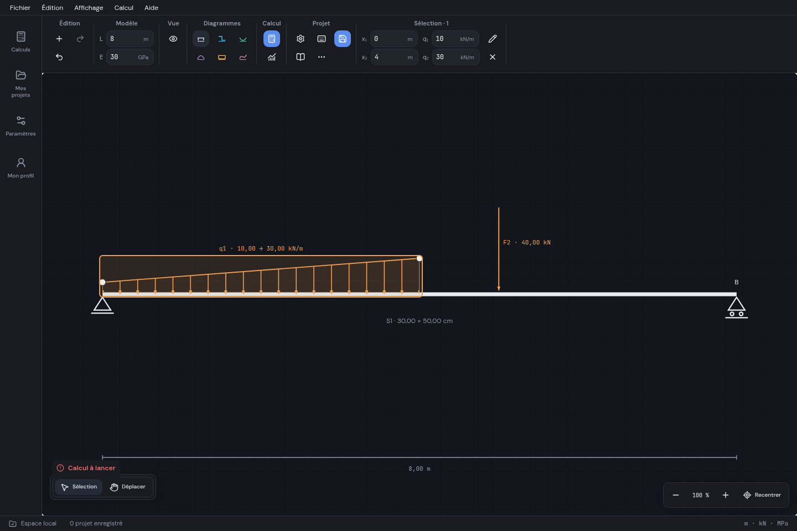
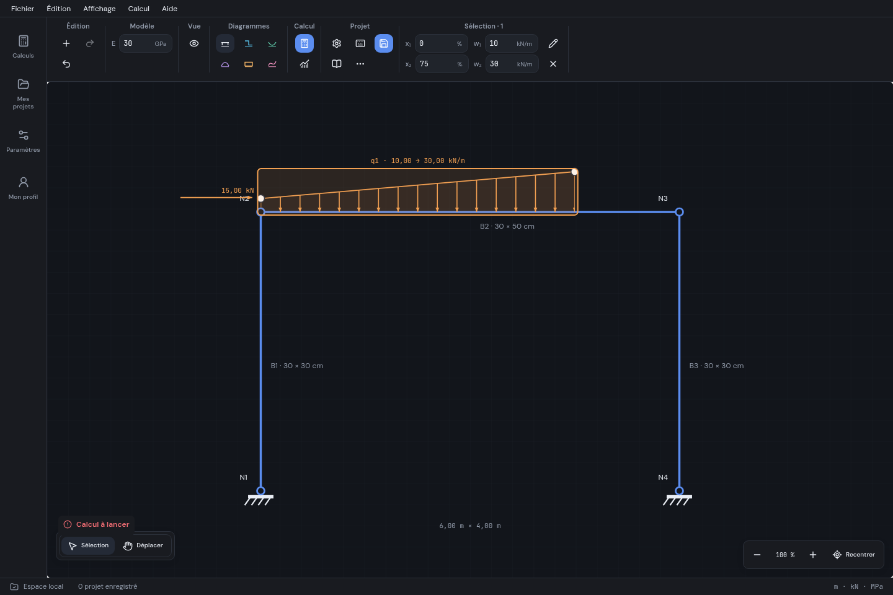
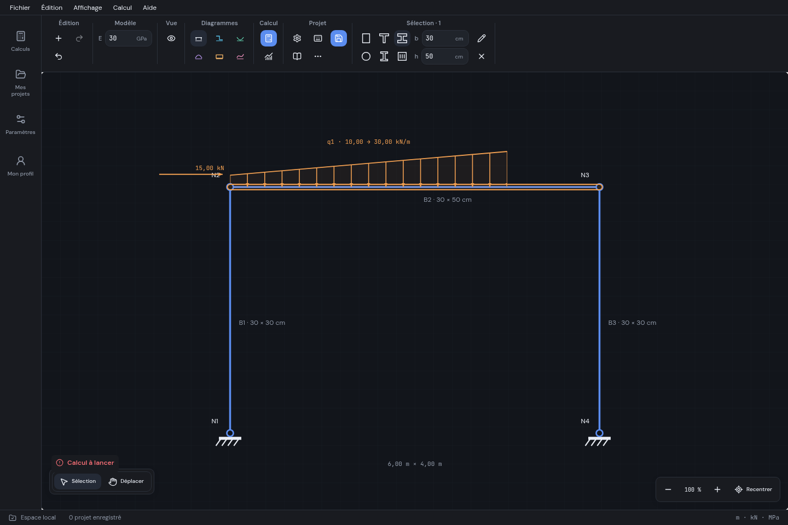
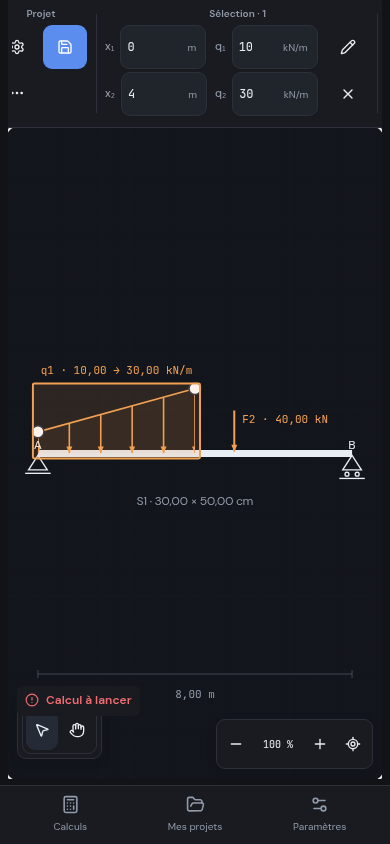
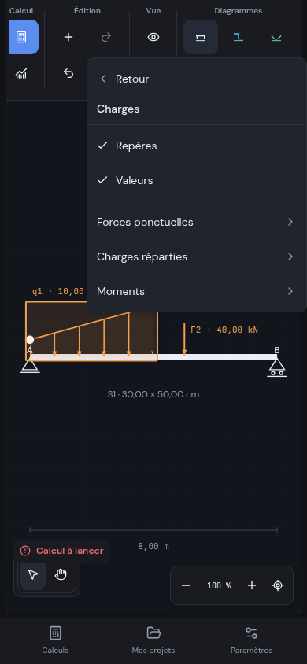
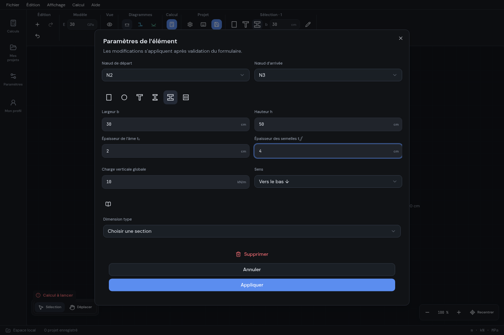
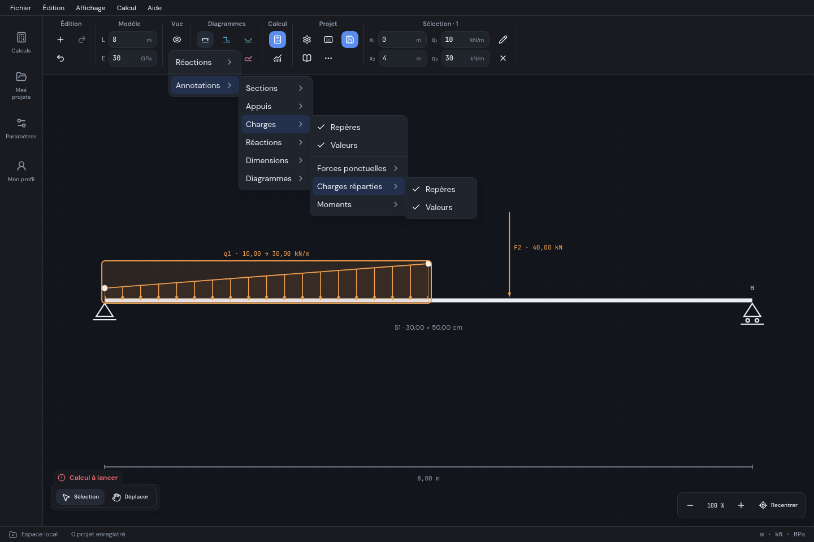
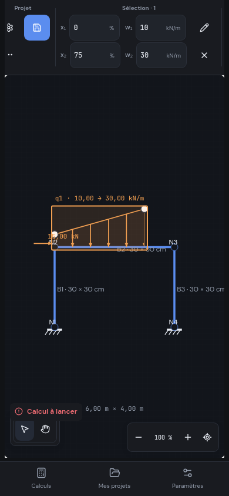

# Édition des poutres et portiques

Les analyses de poutres et de cadres conservent les polices DM Sans / JetBrains Mono, les icônes de projets et les moteurs d’analyse élastique. Cette évolution concerne l’édition et la représentation des modèles.

## Ruban

Le bouton Retour aux calculs est retiré de ces deux projets. Le groupe Projet suit les autres groupes dans le même défilement horizontal ; le groupe de sélection apparaît en dernier et est révélé lors de la sélection. Les hauteurs restent fixes : 104 px en fenêtre large, 128 px en format compact.

Le groupe Vue contient des menus imbriqués : réactions, annotations par famille d’éléments, puis repères et valeurs. Les charges disposent aussi de réglages distincts pour les forces ponctuelles, les charges réparties, les moments de poutres et les charges nodales des cadres. Ces réglages visuels ne modifient pas les données mécaniques. Les réactions restent soumises à un calcul actualisé.

L’icône des paramètres globaux est un engrenage. Le calcul simplifié G/Q est accessible dans les paramètres globaux, en dehors du ruban. Les résumés de sélection présentent seulement les champs essentiels. Le bouton Modifier la sélection et l’action Modifier du menu au clic droit donnent accès à l’éditeur complet, avec application ou annulation. Sur téléphone, cet éditeur utilise le panneau inférieur.

Les nombres du ruban sont formatés sur cinq caractères au repos. Le champ retrouve sa précision complète à la prise de focus ; l’infobulle montre aussi la valeur exacte. Cette présentation ne tronque ni les données enregistrées ni les valeurs transmises aux solveurs.

## Profils

Des boutons illustrés remplacent le sélecteur textuel : rectangle, cercle, T, I, H et propriétés libres. Les dimensions de l’âme et des semelles se règlent dans l’éditeur complet. Les propriétés des profils nommés sont calculées autour de leur axe centroidal de flexion ; I et H emploient la même construction géométrique à deux semelles et une âme, avec les dimensions choisies.

Le moteur de poutres recalcule A, I et l’aire de cisaillement utilisée avec le coefficient κ du modèle. Le moteur de cadres emploie les propriétés du profil pour les rigidités axiale et de flexion. Le mode Propriétés libres conserve la saisie manuelle des propriétés. Il ne s’agit pas d’un catalogue de profilés métalliques normalisés ni d’un calcul de ferraillage.

## Charges réparties

Une charge sélectionnée possède deux poignées blanches : début et fin. Le glissement modifie son intervalle d’application ; le glissement du corps déplace la charge. Les poignées acceptent également les flèches du clavier. Sur téléphone, les poignées se déplacent directement ; le déplacement du corps conserve l’appui long.

Les flèches partent de l’enveloppe interpolée entre les deux intensités. Leur dessin est contenu dans cette enveloppe, y compris pour une charge triangulaire ou changeant de signe. Les intensités restent inchangées pendant l’étirement.

Pour les cadres, la charge est un objet sélectionnable distinct de sa barre. Son intervalle s’exprime en pourcentage de la longueur de barre. La composante w est verticale dans le repère global et positive vers le bas ; la composante qᵧ suit la normale locale. Chaque composante accepte une intensité initiale et finale.

Le calcul subdivise intérieurement les barres aux limites des charges et aux forces ponctuelles. Les charges linéaires utilisent leurs forces nodales cohérentes exactes ; les efforts et déplacements sont recomposés sur les barres originales. Les nœuds auxiliaires restent internes au solveur. Les anciennes charges uniformes couvrent par défaut toute leur barre.

## Captures

Captures du rendu Desktop et mobile, avec simulation de l’intégration Tauri dans Chromium. Les gestes tactiles sont synthétisés ; les builds natifs sont contrôlés séparément dans GitHub Actions.

