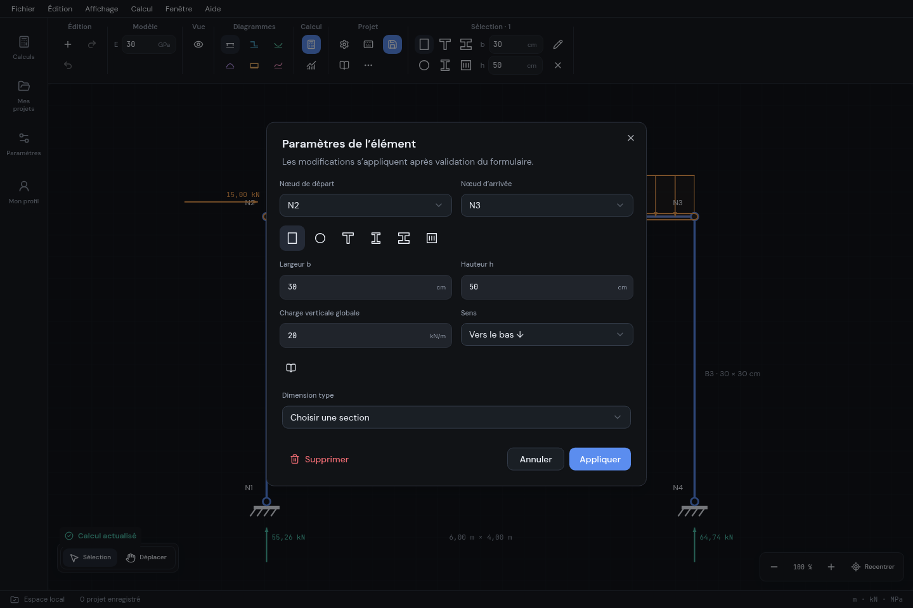
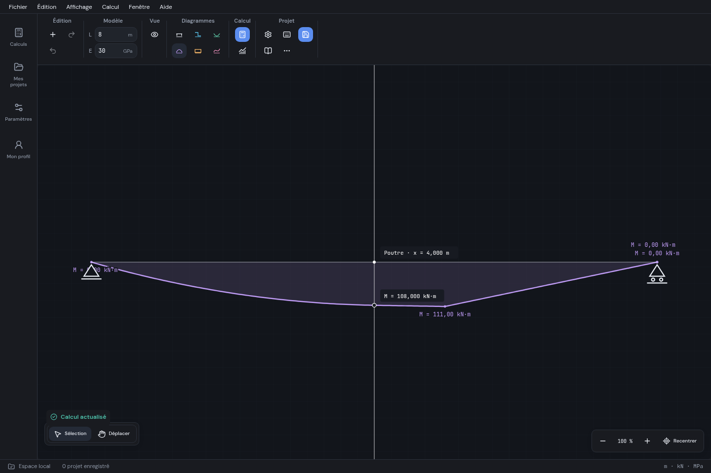
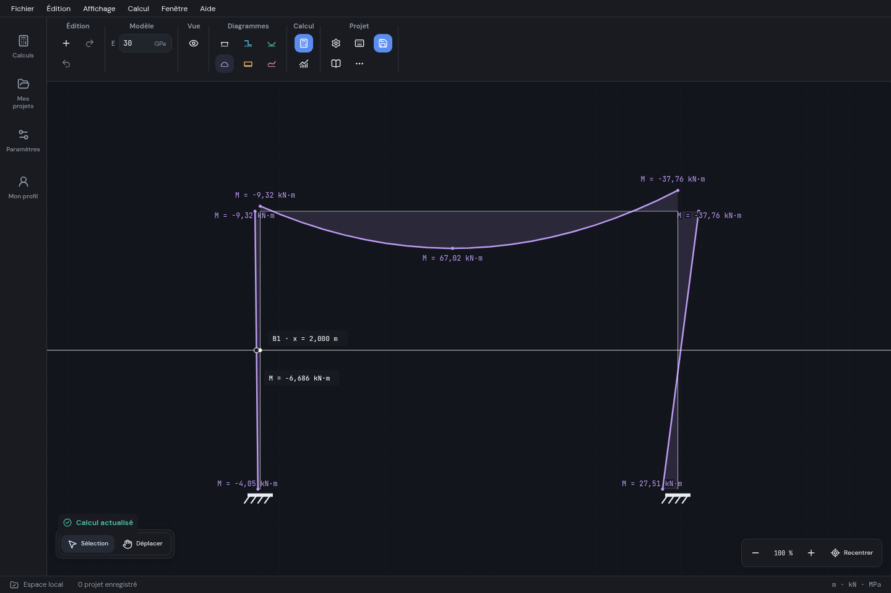
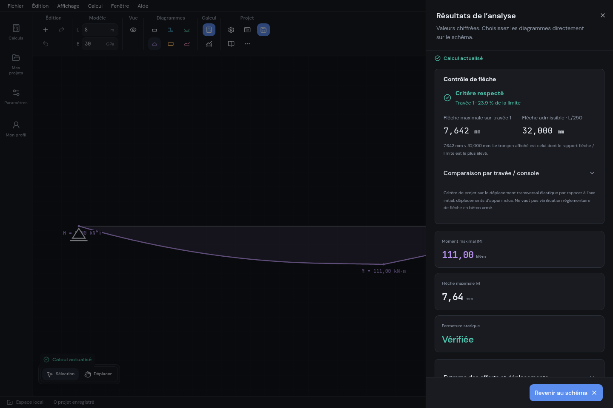
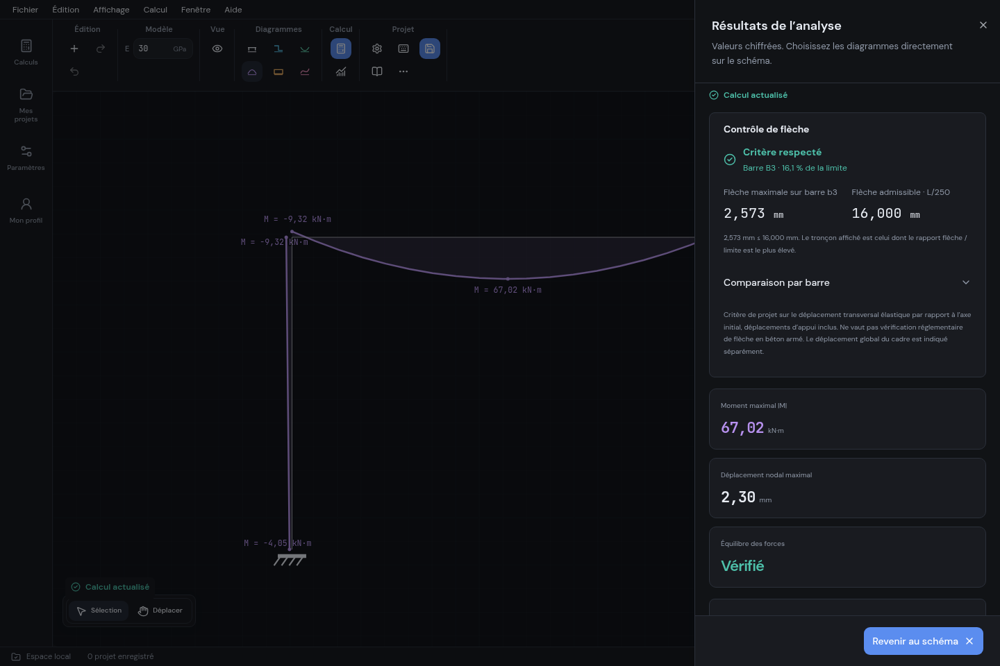
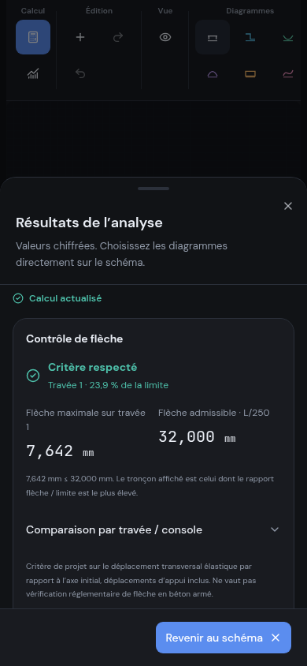
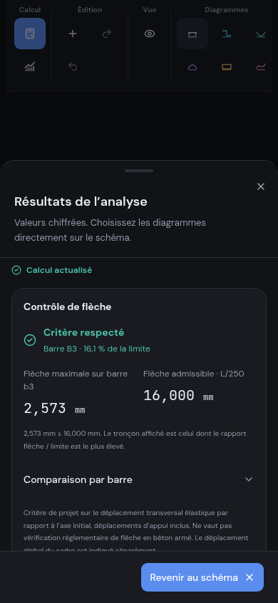

# Menus Desktop et lecture des analyses

Windows et Linux affichent maintenant la même barre de menus stylisée que les captures de l’application. La barre Rust du système n’y est plus installée ; macOS conserve son menu global. Les commandes des menus restent reliées aux actions du projet. F10 ou Alt+F donnent accès au menu, F5 calcule, Ctrl+S enregistre. Le menu Fenêtre appelle les commandes Rust de réduction, de plein écran et de fermeture.

Les formulaires Desktop sont limités à 600 px de largeur, avec une marge de sécurité sur les fenêtres plus étroites. Les espacements des champs et les boutons du pied de formulaire sont compactés. Les formulaires mobiles conservent leur présentation en panneau inférieur.

## Lecture au curseur

Dans les analyses de poutres et de cadres, le curseur se projette sur l’axe initial de la structure. Un trait blanc fin traverse le dessin : vertical pour une poutre horizontale, horizontal pour une barre verticale, perpendiculaire pour une barre inclinée. La barre admissible la plus proche du curseur est utilisée ; aucune lecture n’est produite au-delà de ses extrémités.

La position est mesurée depuis l’origine de la poutre, ou le premier nœud de la barre du cadre. L’unité se choisit dans **Paramètres du modèle → Lecture et flèche admissible → Unité des positions au curseur** : m, cm ou mm. Les unités internes des solveurs ne changent pas.

En vue de diagramme, un second repère affiche la valeur interpolée sur le tracé, avec son unité : kN·m, kN, mm ou mrad. La déformée du cadre indique la norme du déplacement global non amplifié, comme le tracé existant. À une discontinuité, la lecture prend la valeur immédiatement à droite. Le repère suit le zoom et le déplacement du dessin, disparaît à la sortie du curseur et pendant une manipulation, et ne reçoit aucun clic. Il s’agit d’une interaction de survol à la souris ; les gestes tactiles d’édition, de déplacement et de zoom restent disponibles.

## Flèche admissible

Le contrôle de flèche est placé immédiatement après la carte « Flèche maximale |v| » : valeur calculée, limite admissible, pourcentage d’utilisation et texte **Critère respecté** ou **Limite dépassée**. Le détail est disponible pour chaque travée, console ou barre.

Le critère est propre au projet, réglable dans **Paramètres du modèle → Lecture et flèche admissible** : soit L/n (valeur initiale L/250), soit une limite absolue en mm. Les fichiers existants restent lisibles sans migration obligatoire. Changer la limite ou l’unité de lecture ne périme pas les résultats mécaniques. Une modification des données structurales continue de masquer les résultats jusqu’au prochain calcul.

Pour une poutre, L est la distance entre deux appuis verticaux, ou la longueur réelle de la console. Un changement de section ne crée pas de nouvelle travée. Pour un cadre, L est la longueur de chaque barre d’origine. La comparaison utilise le maximum du déplacement transversal par rapport à l’axe initial, déplacements d’appui inclus. Le tronçon présenté en premier est celui dont le rapport déplacement / limite est le plus élevé. Le déplacement axial et la norme du déplacement global du cadre ne sont pas confondus avec ce déplacement transversal.

Ce contrôle élastique porte sur les charges saisies et le critère choisi par l’utilisateur. Il ne constitue pas une vérification réglementaire de flèche en béton armé, avec fissuration et fluage.

## Vérification

Les tests unitaires couvrent la projection, les unités, l’interpolation aux discontinuités, les portées et consoles, la flexion analytique d’une poutre et d’une console de cadre, et la séparation du déplacement axial. Les parcours navigateur couvrent la barre stylisée, le clavier, la largeur des dialogues, la projection après zoom et pan, les unités des diagrammes, le changement de critère et sa persistance Desktop/mobile.

Les captures ci-dessus utilisent Chromium avec l’intégration Tauri simulée. Le workflow Windows lance également le véritable EXE dans WebView2 : il exige la présence de la barre stylisée, utilise son menu Calcul, vérifie le repère et le contrôle de flèche, puis relit le projet sauvegardé en mode de compatibilité. Ses captures se trouvent dans l’artefact de diagnostics natifs.

La [lecture précise et la navigation du bâtiment](structural-navigation.md) présentent la saisie au clavier, le mode tactile et les nouvelles commandes du bâtiment.
