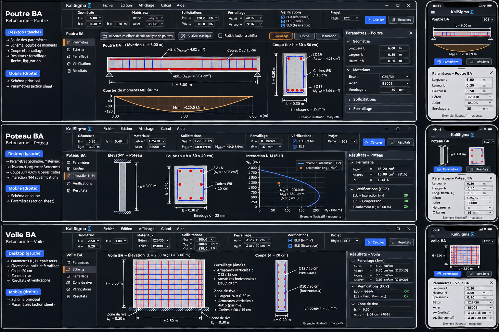
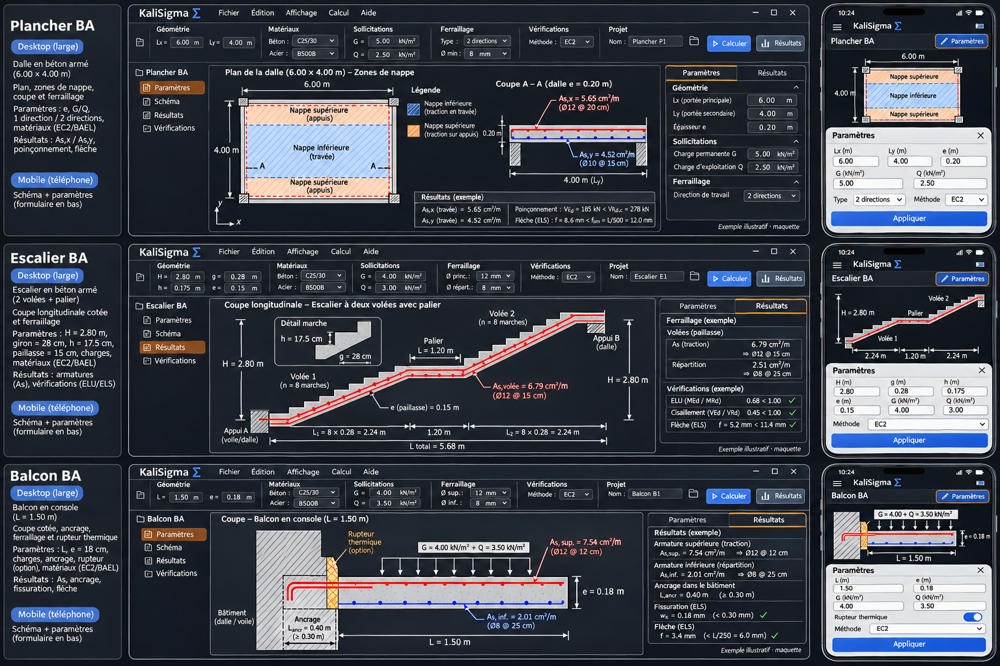
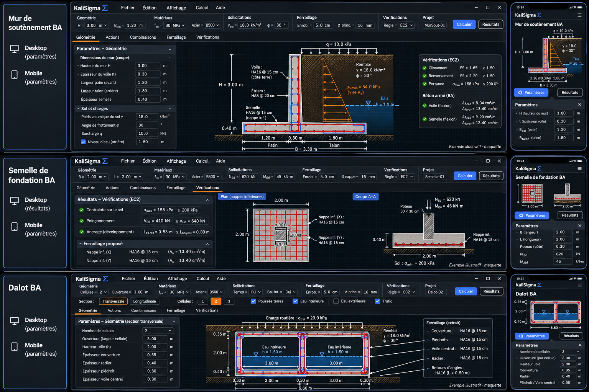

# Propositions visuelles — Dimensionnement béton armé

Ces planches sont des maquettes générées, pas des captures d’un module codé. Les chiffres, armatures et états de vérification sont illustratifs : ils ne constituent pas des résultats calculés ou des détails d’exécution. Les éventuelles incohérences de valeurs entre les vues seront éliminées au passage aux composants réels, après validation de la direction.

Chaque projet possède un schéma principal, une coupe annotée et des paramètres identifiables. Le Desktop conserve le ruban de KaliSigma et la barre de menus ; le mobile utilise un schéma lisible et un formulaire en sheet basse.

## Poutre, poteau et voile

Poutre : import des sollicitations depuis l’analyse structurale, choix de la méthode admissible selon la norme, ferraillage longitudinal/transversal, flèche et fissuration. Les méthodes simplifiées ou redistributions devront être proposées avec leurs conditions d’application, sans remplacer silencieusement l’analyse élastique.

Poteau : section et élévation, longueur de flambement, N/M dans les deux directions, interaction et disposition des barres. Voile : dimensions, charges, armatures verticales/horizontales et zones de rive.

## Plancher, escalier et balcon

Plancher : fonctionnement dans une/deux directions, nappes, coupes et poinçonnement selon les appuis. Escalier : géométrie des volées et paliers, charges, paillasse et ancrages. Balcon : console, armatures supérieures, ancrage et vérifications de service.

## Soutènement, semelle et dalot

Le dalot proposé possède des cellules configurables, une coupe transversale/longitudinale, un radier, des piédroits et des voiles intermédiaires. Les actions à distinguer sont le remblai, le trafic, les poussées de terres, l’eau intérieure/extérieure et les cas de remplissage. Les vérifications BA et géotechniques seront séparées et associées aux combinaisons applicables.

Les huit projets BA existants et le dalot sont représentés. Aucun nouvel écran de dimensionnement, moteur BA ou type Dalot n’est implémenté par cette proposition.
