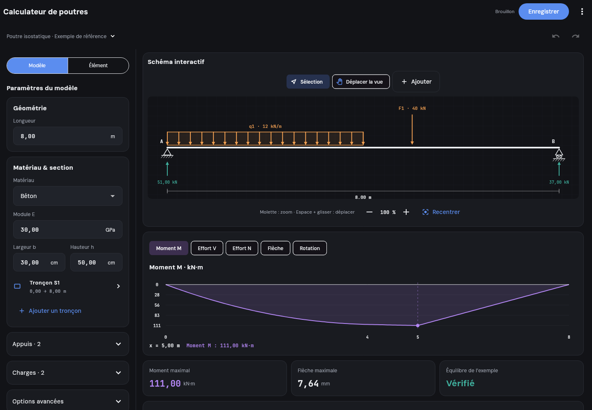
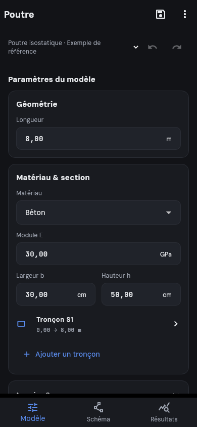
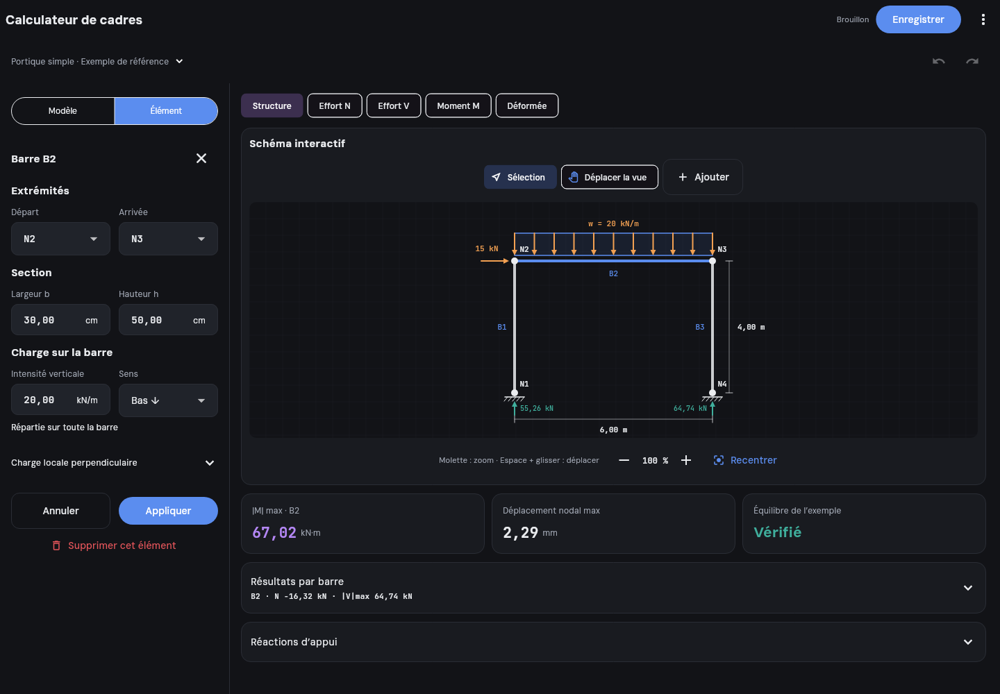
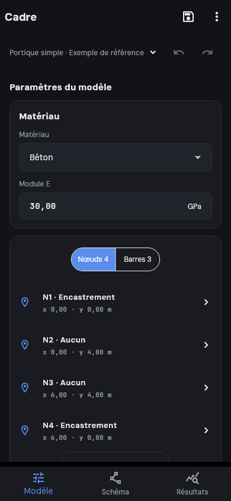

# Pages des calculateurs

Les entrées **Calculateur de poutres** et **Calculateur de cadres** ouvrent les pages des maquettes validées.

## Interface

- À partir de 1000 px : inspecteur à gauche et playground/résultats à droite, avec défilement indépendant.
- En dessous : navigation **Modèle / Schéma / Résultats** et éditeur contextuel dans un volet mobile.
- Sélection d'une charge, d'un appui, d'un tronçon, d'un nœud ou d'une barre depuis le schéma ou les listes.
- Champs numériques avec unités, virgule ou point décimal, sens des forces explicite et validation avant application.
- Ajout, suppression, annulation/rétablissement, modèles prédéfinis et sauvegarde locale par calculateur.
- Zoom à la molette ou au pincement, pan tactile/souris, mode main, raccourci Espace + glisser et boutons de recentrage/zoom.
- Les tableaux et options avancées s'ouvrent à la demande. Un seul diagramme est présenté à la fois.

La longueur de poutre se redimensionne en conservant les positions relatives des éléments ; les positions restent éditables individuellement. Les références entre nœuds et barres utilisent des identifiants stables. Supprimer un nœud supprime aussi les barres qui lui sont rattachées. Un ajout annulé ne modifie pas le modèle appliqué.

## Polices conservées

Aucun changement de `pubspec.yaml`, des fichiers de fontes ni d'`AppTheme` :

- **DM Sans**, via le thème et `AppTheme.uiFontFamily`, pour les textes et les commandes.
- **JetBrains Mono**, via `AppTheme.monoTextStyle` et `AppTheme.monoFontFamily`, pour les champs numériques, mesures, valeurs et graduations des schémas.

## Périmètre de cette étape : les pages

Cette modification implémente l'interface et ses interactions, conformément à la demande de pages uniquement. Elle ne porte pas les solveurs généraux des fichiers HTML dans Dart.

Les courbes et valeurs initiales sont les **exemples de référence** des fichiers fournis : poutre de 8 m (charge de 12 kN/m sur 4 m et force de 40 kN à 5 m) et portique de 6 × 4 m (20 kN/m sur la traverse, force horizontale de 15 kN). Les données sont explicitement identifiées comme telles. Si le modèle appliqué diffère de la référence, les réactions, courbes et contrôles d'équilibre de cet exemple sont masqués : aucun résultat périmé n'est présenté comme un nouveau calcul.

Les calculateurs simplifiés G/Q existants restent accessibles dans le menu **Calcul simplifié G/Q**, sans modification de leurs fonctions dans `domain/beam_analysis.dart`. Le futur raccordement d'un solveur général peut réutiliser `CalculatorModel` et fournir des résultats correspondant au modèle appliqué.

## Aperçus Flutter réels

Les images sont aussi les références des tests visuels, avec les deux fontes de l'application chargées :

Validation : `flutter analyze` et `flutter test`. Les tests couvrent notamment les fontes, les quatre dispositions, le zoom/pan/recentrage, la virgule décimale, l'application/annulation des formulaires, les vues avec clavier, les fenêtres étroites et le texte agrandi, l'ajout provisoire, l'historique, les liaisons entre éléments et la reprise d'une sauvegarde.
