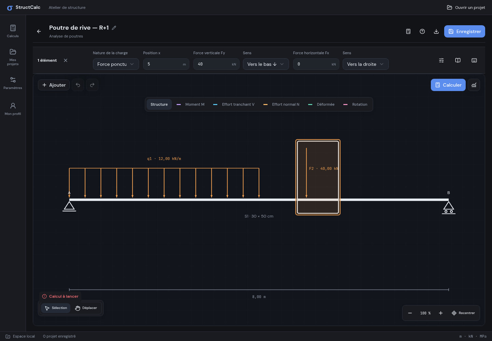
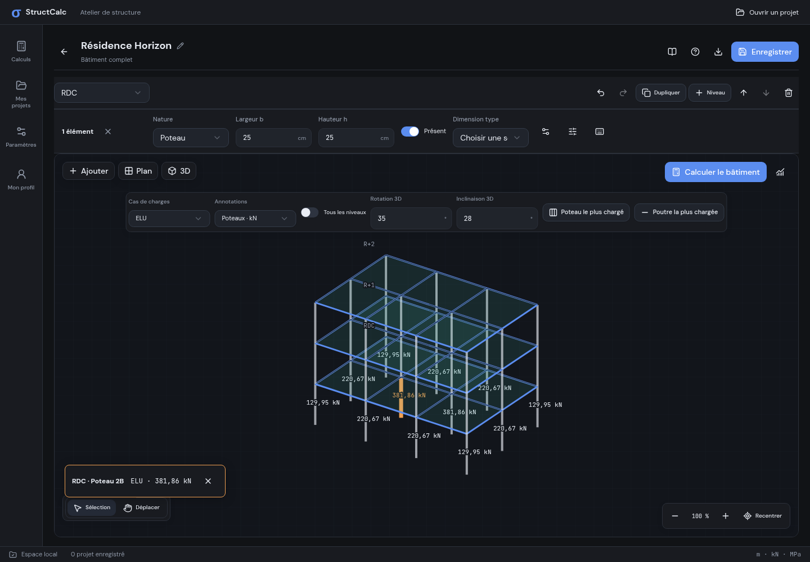
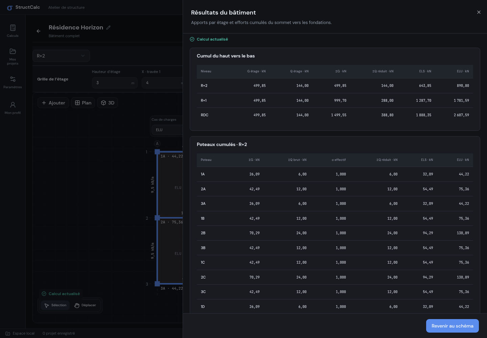
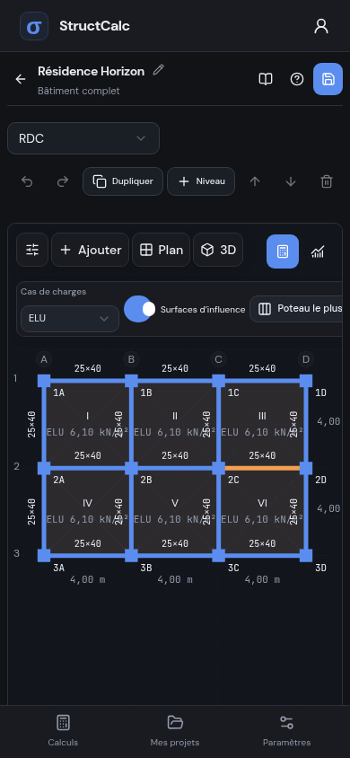

# Atelier Desktop et descente gravitaire du bâtiment

Cette évolution conserve les polices DM Sans / JetBrains Mono et les icônes approuvées. Le mode Desktop est celui de l’application Tauri ; le navigateur conserve son mode web et le téléphone ses panneaux inférieurs.

## Créer et éditer

Le nom est demandé sur l’écran de départ, avant de monter le modèle ou de naviguer vers le projet. Entrée valide le nom ; Annuler reste sur l’écran précédent. Un lien direct `/new/...` présente également le nom avant d’instancier le modèle. Les études enregistrées s’ouvrent directement.

Sur Desktop, les textes de l’interface ne sont pas sélectionnables. Les champs restent sélectionnables et éditables au clavier. Le menu contextuel de la WebView est supprimé. Dans les schémas, un menu métier remplace celui du navigateur.

- Clic gauche : sélectionner et modifier dans la barre de paramètres.
- Shift + clic : ajouter ou retirer un élément de même nature.
- Ctrl / Cmd A : tous les éléments de la même nature que la sélection courante.
- Ctrl / Cmd C et V : copier puis appliquer les propriétés aux éléments compatibles. Les identifiants, positions et connexions sont conservés.
- Suppr : supprimer ; Ctrl / Cmd Z et Shift Z (ou Ctrl Y) : annuler et rétablir.
- Inser ou Ctrl N : ouvrir Ajouter. Échap : désélectionner.
- Clic droit : menu de sélection. Clic gauche maintenu + glisser : déplacer un appui, une force ou une charge répartie sur la poutre, ou une force ponctuelle attachée à une barre de portique.
- Molette : zoom ; Espace + glisser : pan ; 0 : recentrer.

Les raccourcis de sélection du modèle n’interceptent pas la saisie dans les champs, dialogues ou menus. Les opérations sont limitées au projet ouvert. Les paramètres détaillés se consultent dans des dialogues et les résultats dans un panneau droit.

Chaque projet conserve sa propre liste `sectionTypes`, exportée et sauvegardée avec ses données. Les anciennes listes globales sont conservées en archive dans les paramètres, mais ne pilotent plus les sections des projets.

## Poteau : poids propres et réduction de Q

Le plancher 16+4 utilise **2,85 kN/m²**, la valeur demandée pour ce produit. Il s’agit d’un poids surfacique, pas d’un poids volumique.

Pour le système poteaux–poutres–dalles, les poutres principales et secondaires apportent respectivement :

```
Gp = 25 × bp × hp × (L1 + L2)
Gs = 25 × bs × hs × (L3 + L4)
```

Les sections sont converties des cm en m. Les longueurs sont les longueurs d’influence complètes saisies dans ce projet ; elles ne sont pas divisées à nouveau par deux. Pour le système poteaux–dalles, ces deux termes sont nuls. Le poids du poteau (ou du voile dans la descente de voile) est ajouté à chaque étage. Les sections entières sont comptées : cette méthode simplifiée ne soustrait pas les volumes d’intersection avec les planchers.

La règle de dégression est enregistrée dans le projet et visible dans les paramètres :

| Règle                           | Catégories couvertes          | Coefficient pour n étages de même catégorie                    |
| ------------------------------- | ----------------------------- | -------------------------------------------------------------- |
| Aucune                          | Toutes                        | 1                                                              |
| EN 1991-1-1, valeur recommandée | A à D                         | 1 pour n ≤ 2 ; ensuite `(2 + (n − 2) × 0,7) / n`               |
| Annexe nationale française      | A                             | 1 pour n ≤ 2 ; ensuite `min(1 ; 0,5 + 1,36 / n)`               |
| Annexe nationale française      | B                             | 1 pour n ≤ 2 ; ensuite `min(1 ; 0,7 + 0,8 / n)`                |
| NF P 06-001, historique         | A et B dans cette application | 1, 0,95, 0,90, 0,85, 0,80 pour n = 1…5 ; puis `(3 + n) / (2n)` |

Les catégories non couvertes restent entières, notamment E et H. Plusieurs panneaux d’un même étage ne comptent qu’une fois dans n. Les contributions sont regroupées par catégorie et la réduction est appliquée **au cumul brut**, jamais aux valeurs déjà réduites d’un étage supérieur. En ELS quasi permanent de la descente isolée, les coefficients ψ₂ par catégorie s’appliquent au Q brut, sans multiplication supplémentaire par αn. Il n’y a pas de réduction de surface αA supplémentaire.

Les projets anciens sans règle explicite chargent « Aucune dégression » pour ne pas réduire silencieusement des études existantes ; les nouveaux projets proposent la valeur recommandée EN. Le choix de l’annexe nationale reste visible et modifiable.

Sources consultées : [EN 1991-1-1](https://www.scbh-deschaux.fr/Eurocode/NORMES/EN%201991%201-1.pdf), [ADETS, murs en béton — dégression EC1 et annexe française](https://www.adets.fr/images/1_Livre/Chapitre-4---Les-murs-en-bton.pdf), [manuel AQCEN, tronc commun](https://www.scbh-deschaux.fr/Eurocode/MANUELS/1%20Tronc%20commun.pdf), [formation OFPPT, méthode NF P 06-001](https://ofppt.info/wp-content/uploads/2021/01/Application-des-r%C3%A8gles-de-b%C3%A9ton-arm%C3%A9-aux-%C3%A9tats-limites-BAEL-TSGO.pdf). Les formules ne constituent pas une vérification complète des combinaisons réglementaires de chaque ouvrage.

## Bâtiment : du sommet aux fondations

Les niveaux sont rangés du bas vers le haut dans le modèle. Le calcul parcourt cette liste en sens inverse, en gardant les contributions G et Q distinctes.

1. Les panneaux apportent leur poids propre, leurs revêtements et Q aux rives porteuses selon leurs surfaces d’influence à 45°. Si une séparatrice est absente, les surfaces sont réparties proportionnellement entre les rives restantes ; ce modèle ne résout pas une dalle par éléments finis.
2. Le poids propre de chaque poutre et voile est ajouté. Les poutres transmettent leurs réactions isostatiques aux poteaux d’extrémité ; les voiles conservent leur descente verticale.
3. Les poteaux reçoivent leur poids propre et les efforts des poteaux géométriquement alignés à l’étage supérieur. Les voiles superposés transmettent leurs charges aux voiles inférieurs alignés.
4. La dégression Q est appliquée une fois par niveau aux porteurs verticaux. Les poutres d’étage gardent Q entier.
5. Le tableau présente les apports locaux, ΣG, ΣQ réduit, ELS et ELU du sommet vers le RDC. Les tableaux des poteaux présentent aussi Q brut et le coefficient effectif.

Un appui absent, un panneau sans rive porteuse ou un porteur supérieur sans porteur inférieur aligné bloque le calcul avec son emplacement. Aucune charge ne disparaît silencieusement. Les poutres de transfert et la redistribution globale par rigidité ne sont pas simulées. Les éléments libres ont des charges explicites ; les poutres libres transmettent aux poteaux de grille situés exactement à leurs extrémités, et les poteaux libres sont cumulés entre positions alignées. Leur catégorie d’usage étant absente du modèle, leur Q reste entier.

La vue 3D est une projection orthographique de la géométrie du bâtiment, avec rotation, inclinaison, zoom et pan. Les annotations se choisissent par type et par niveau : kN/m² pour les panneaux, kN/m pour les poutres et voiles, kN pour les poteaux. Les cas sont G, Q, ELS = G + Q et ELU = 1,35G + 1,5Q. Les boutons de recherche comparent tous les niveaux : effort cumulé pour le poteau, charge linéique pour la poutre. La sélection orange affiche la valeur du cas choisi. Les résultats et repères deviennent indisponibles dès modification du modèle.

## Forces attachées aux barres des portiques

Le modèle conserve un membre et une position relative t ∈ [0 ; 1]. Le solveur subdivise intérieurement la barre aux positions des forces et assemble les nœuds supplémentaires avec les mêmes éléments de portique. Les résultats sont ensuite recomposés par barre originale. Les nœuds internes n’apparaissent pas dans les paramètres, et les réactions, efforts, déplacements et rotations sont recalculés ensemble. Des tests analytiques vérifient les réactions et le moment d’une poutre simplement appuyée avant et après déplacement de la force, ainsi que sa flèche centrale.

## Direction et validation

Direction UX adaptée du skill [Impeccable, Paul Bakaus](https://github.com/pbakaus/impeccable) : atelier d’édition, hiérarchie compacte, commandes de souris et clavier, détails accessibles et maintien du contexte du schéma. Le chargement automatique du contexte n’a pas pu écrire son cache ; les guides d’adaptation, Operate et craft-floor ont été lus directement.

Les captures et parcours automatisés utilisent Chromium avec la frontière IPC Tauri simulée pour le stockage et le choix du layout natif. Ils ne remplacent pas un essai physique sous Windows/Android. Les builds natifs et le test du véritable EXE Windows sont suivis dans GitHub Actions.

## Captures de revue

Build de production, interface Desktop en 1440 × 1000 et mobile en 390 × 844. Les polices et les icônes de projets existantes sont conservées.

### Paramètres de l’élément sélectionné dans la barre Desktop



### Vue 3D et poteau le plus chargé à l’ELU



### Apports par étage et cumul jusqu’au RDC



### Plan du bâtiment sur mobile


