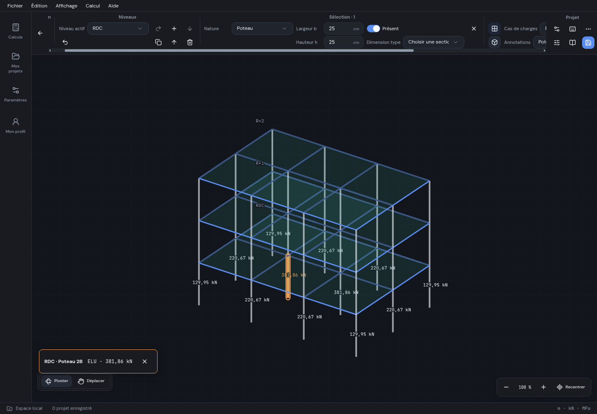
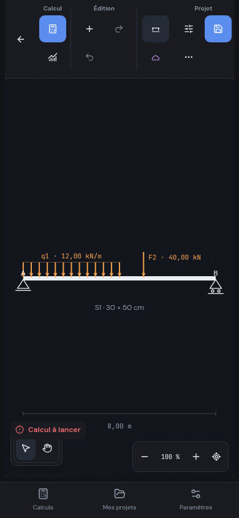
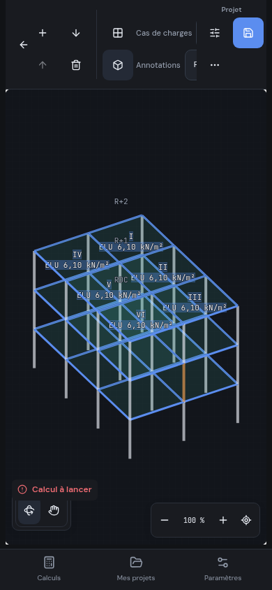
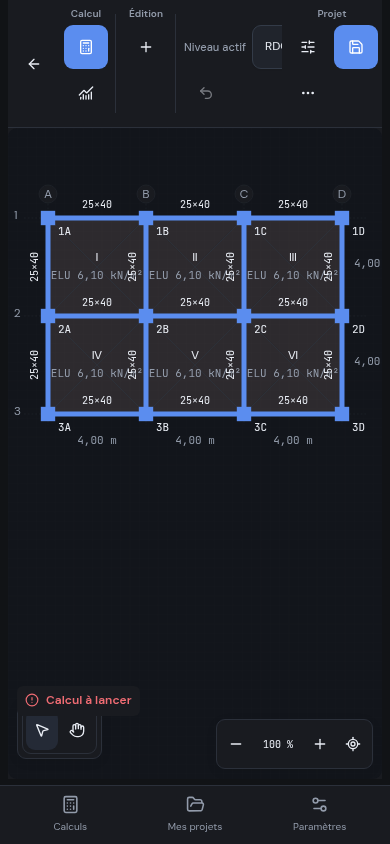

# Ruban unique et navigation 3D

Les études de poutres, de portiques plans et de bâtiment utilisent un seul ruban de projet. Les polices DM Sans / JetBrains Mono et les icônes des projets approuvées sont conservées.

## Disposition

Le ruban fait **104 px** sur une fenêtre large et **128 px** sous 1000 px, indépendamment du nombre d’éléments sélectionnés, de leurs paramètres ou de la vue Plan / 3D. Chaque groupe porte un titre centré ; les séparateurs verticaux restent en retrait des bords. Les champs se lisent du haut vers le bas, au maximum deux par colonne, puis de gauche à droite. Les réglages détaillés restent disponibles dans les dialogues Desktop et les panneaux inférieurs sur téléphone.

Les groupes rassemblent l’édition, les niveaux du bâtiment, les paramètres du modèle ou de la sélection, les vues et diagrammes, les charges critiques et le calcul. Les commandes qui flottaient au-dessus du dessin font désormais partie de ce même ruban. Les actions utilisent des icônes avec noms accessibles et infobulles. Le groupe Projet, avec l’enregistrement et les autres actions, reste à droite. Sur téléphone, le calcul et les résultats sont placés au début du défilement pour être immédiatement accessibles.

Le nom de l’étude n’occupe plus de champ dans le ruban. Le nom demandé à la création, la sauvegarde et le renommage depuis le menu du projet / Fichier restent disponibles ; un titre sémantique est conservé pour les technologies d’assistance.

Quand les groupes dépassent la largeur disponible, seule la zone des outils défile horizontalement, avec une barre fine adaptée au thème. Les menus et listes déroulantes apparaissent au-dessus du ruban. Les commandes tactiles ont une cible de 44 px. Le header général reste masqué dans ces trois espaces ; le ruban commence sous la zone de sécurité du téléphone.

## Menus Desktop

L’application Tauri installe une barre de menus du système : Fichier, Édition, Affichage, Calcul, Fenêtre et Aide. macOS dispose aussi du menu StructCalc avec réglages, services, masquage et fermeture ; les menus Fenêtre et Aide prennent leurs rôles système. Windows et Linux utilisent la barre native de la fenêtre.

Les menus commandent le projet actif : ouvrir/créer/importer, enregistrer/exporter/renommer, édition de la sélection, zoom/recentrage, paramètres, résultats, calcul et guide. Enregistrer utilise Ctrl/Cmd S, ouvrir Ctrl/Cmd O, nouveau projet Ctrl/Cmd Shift N et calcul F5.

La barre HTML des prévisualisations sert de repli lorsque le menu natif n’est pas disponible. Elle disparaît quand la liaison Tauri est active. Aucun menu Desktop n’est ajouté sur mobile.

## Déplacement des éléments

- **Clic gauche maintenu + glisser** : déplacer les appuis, charges et rotules d’une poutre le long de celle-ci ; déplacer une force affectée à une barre de portique le long de sa barre ; déplacer les poutres et poteaux libres du plan du bâtiment.
- **Clic droit** : ouvrir les actions de l’élément. Un glissement avec le bouton droit ne déplace plus d’élément.
- **Sur téléphone** : un appui long de 350 ms prépare le déplacement d’un élément ; un glissement court déplace la vue ; un toucher ouvre les paramètres.
- **Annulation** : une interruption du geste restaure la position initiale. Un déplacement terminé produit une seule opération dans l’historique ; un simple clic n’en ajoute aucune.

Les déplacements tiennent compte du zoom et de l’échelle du dessin. La longueur d’une charge répartie ou d’une poutre libre est conservée. Les éléments de la grille du bâtiment restent définis par leurs travées.

## Pivoter le bâtiment

Les deux champs numériques d’angle ont été retirés. Les angles restent des réglages de caméra, indépendants des dimensions, des charges, de l’historique et de l’actualité du calcul.

- **Glisser au clic gauche** : pivoter et incliner le modèle.
- **Déplacer**, **Espace + glisser**, clic central ou clic droit maintenu : déplacer la vue.
- **Molette** : zoomer. **Recentrer** ou **0** : restaurer le cadrage et les angles initiaux.
- **Flèches du clavier** : pivoter sans souris.
- **Un doigt** : pivoter ; **deux doigts** : pincer pour zoomer et déplacer la vue.

## Captures

Captures du bundle de production dans Chromium, avec simulation de l’intégration Tauri. Les gestes tactiles sont synthétisés dans Chromium ; la compilation et le lancement Windows sont vérifiés séparément par GitHub Actions.

