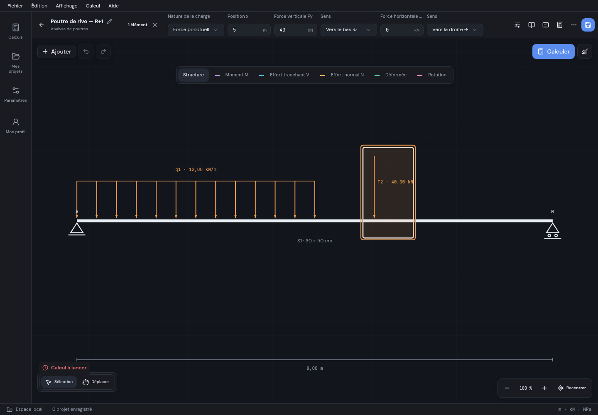

# Header unique et navigation 3D

Les études de poutres, de portiques plans et de bâtiment utilisent un seul header de projet. Les polices DM Sans / JetBrains Mono et les icônes approuvées sont conservées.

## Un espace de dessin stable

Sur Desktop en format large, le header fait **64 px** : nom de l’étude, niveau actif pour le bâtiment, paramètres du modèle ou de la sélection, puis actions du projet. La sélection d’une force, d’une section, d’un appui ou d’un élément du bâtiment ne déplace plus le schéma. Les groupes de paramètres défilent horizontalement quand la fenêtre est étroite ; les boutons de paramètres et d’enregistrement restent accessibles à droite. Les réglages détaillés restent dans des dialogues. Sous 1000 px, une fenêtre Desktop utilise deux rangées dans le même header de 108 px.

Sur téléphone, le header fait **56 px** pour les analyses et **108 px** pour le bâtiment, qui conserve un accès aux niveaux dans le même composant. L’ancien header général disparaît dans ces trois espaces de travail. Les paramètres s’ouvrent dans les panneaux inférieurs. Les outils secondaires sont accessibles depuis « Autres actions du projet ». Les commandes tactiles du header ont une cible de 48 px. Les barres horizontales défilent dans leur propre zone, sans élargir la page.

## Menus Desktop

L’application Tauri installe une véritable barre de menus du système : Fichier, Édition, Affichage, Calcul, Fenêtre et Aide. macOS dispose aussi du menu StructCalc avec réglages, services, masquage et fermeture ; les menus Fenêtre et Aide prennent leurs rôles système. Windows et Linux utilisent la barre de menus native de la fenêtre.

Les menus commandent le projet actif : ouvrir/créer/importer, enregistrer/exporter/renommer, édition de la sélection, zoom/recentrage, paramètres, résultats, calcul et guide. Les actions d’édition et de dessin sont désactivées hors des trois éditeurs concernés. Les raccourcis de saisie restent traités par les champs ; les raccourcis de sélection et de propriétés existants sont conservés. Enregistrer utilise Ctrl/Cmd S, ouvrir Ctrl/Cmd O, nouveau projet Ctrl/Cmd Shift N et calcul F5.

La barre HTML visible dans les captures de prévisualisation sert de repli accessible lorsque le menu natif n’est pas disponible. Elle disparaît quand la liaison Tauri est active. Aucun menu Desktop n’est ajouté sur mobile.

## Pivoter le bâtiment

- **Glisser à la souris** : pivoter horizontalement et incliner le modèle. Le déplacement du pointeur est indépendant du niveau de zoom.
- **Déplacer**, **Espace + glisser**, clic central ou clic droit maintenu : déplacer la vue.
- **Molette** : zoomer. **Recentrer** ou **0** : restaurer le cadrage et les angles initiaux.
- **Flèches du clavier** : pivoter sans souris.
- **Un doigt** : pivoter ; **deux doigts** : pincer pour zoomer et déplacer la vue.

Un clic sélectionne l’élément ; un glissement ne déclenche pas de sélection ni de panneau d’édition. Les changements de caméra ne modifient pas les dimensions, les charges, l’historique du modèle ou l’actualité du calcul.

## Revue visuelle

Direction adaptée du skill [Impeccable](https://github.com/pbakaus/impeccable), guides Layout, Operate et adaptation native : un atelier dense, stable et pilotable au clavier et à la souris. Le moteur automatique de contexte et de détection n’a pas pu accéder à son cache ; les guides ont été lus directement et la disposition contrôlée sur le rendu.

Les captures ci-dessous proviennent du build de production dans Chromium avec liaison IPC simulée pour le stockage et le choix du layout. Elles ne représentent pas un essai sur téléphone physique. Les builds natifs et l’ouverture du véritable EXE Windows sont contrôlés séparément dans GitHub Actions ; le test Windows vérifie aussi l’installation du menu et son canal d’événements Tauri.

### Analyse et paramètres de la sélection

### Bâtiment complet

### Analyse sur mobile

### Rotation du bâtiment sur mobile

