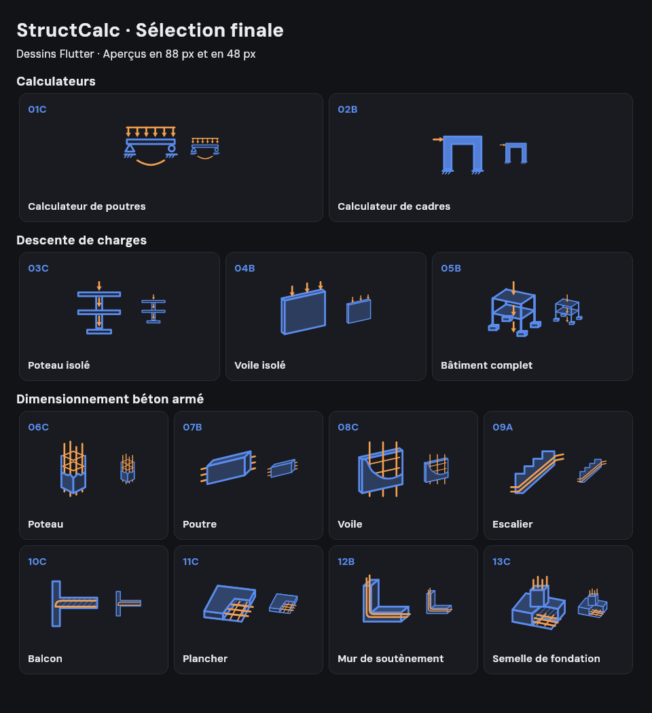
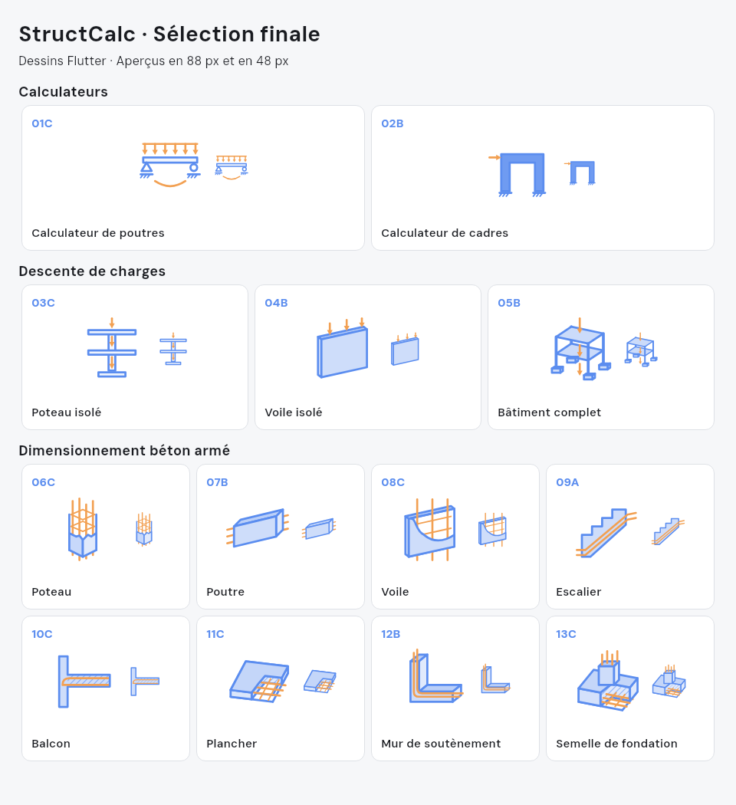

# Icônes des projets

Les 13 dessins vectoriels de `StructIcon` reprennent la sélection validée :

| Choix | Projet | Dessin |
| --- | --- | --- |
| 01C | Calculateur de poutres | Poutre 2D sur appuis, charge répartie et courbe de flexion. |
| 02B | Calculateur de cadres | Portique 2D plein et force horizontale. |
| 03C | Descente sur poteau isolé | Élévation 2D avec deux planchers et cheminement vertical des charges. |
| 04B | Descente sur voile isolé | Panneau mince en axonométrie et charges descendantes. |
| 05B | Descente sur bâtiment complet | Ossature à deux niveaux, planchers et fondations reliés. |
| 06C | Poteau | Béton en coupe, barres longitudinales verticales et étriers. |
| 07B | Poutre | Volume avec barres longitudinales dépassant de ses deux extrémités. |
| 08C | Voile | Coupe du panneau révélant les armatures verticales et transversales. |
| 09A | Escalier | Vue latérale 2D avec armatures continues suivant la paillasse. |
| 10C | Balcon | Coupe 2D montrant l'ancrage des armatures dans le support. |
| 11C | Plancher | Dalle en coupe laissant apparaître la nappe d'armatures. |
| 12B | Mur de soutènement | Volume en L avec armatures longitudinales coudées. |
| 13C | Semelle de fondation | Coupe révélant la nappe inférieure et les attentes du poteau. |

La structure utilise le bleu et les charges ou l'acier l'orange. Les faces du béton s'adaptent au thème. Les cartes du tableau de bord affichent les icônes en 48 px ; leur hauteur s'adapte aux libellés et à l'agrandissement du texte. Les projets récents reprennent les mêmes symboles de descente de charges.

Les aperçus ci-dessous sont rendus par les **widgets Flutter réels**, en 88 px et 48 px. Ils servent aussi de références aux tests visuels :





Validation :

```bash
flutter analyze
flutter test
```

Après une modification intentionnelle des dessins, régénérez les références, puis inspectez les deux images avant de les valider :

```bash
flutter test --update-goldens test/struct_icon_visual_test.dart
```
