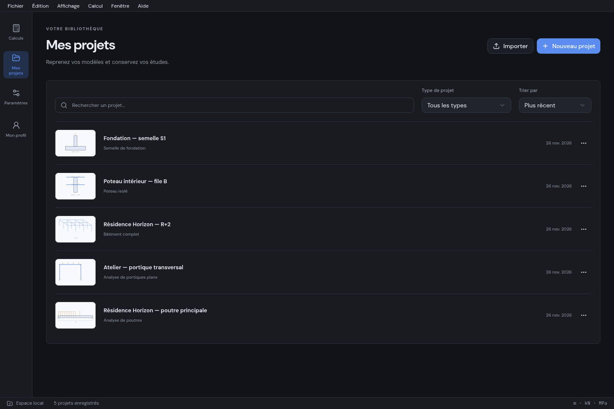
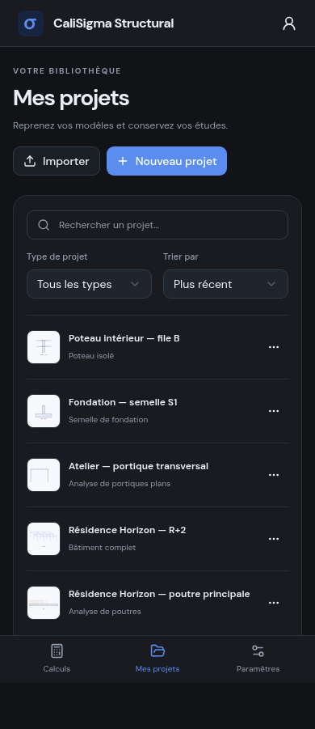
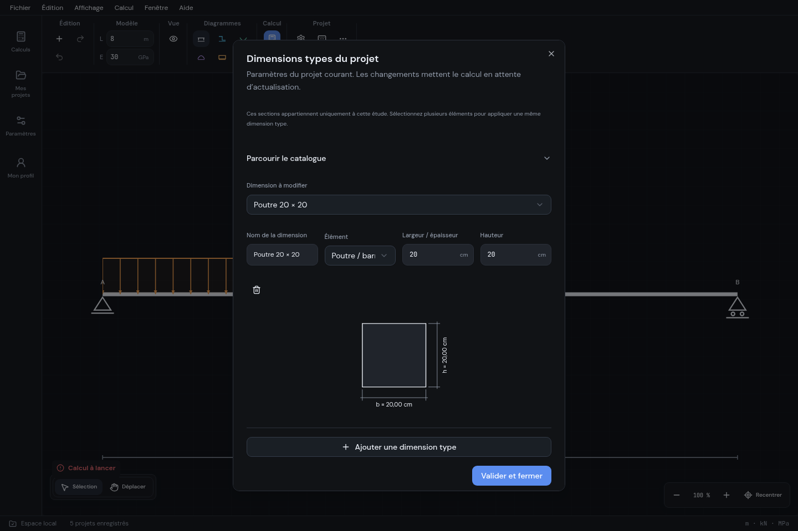
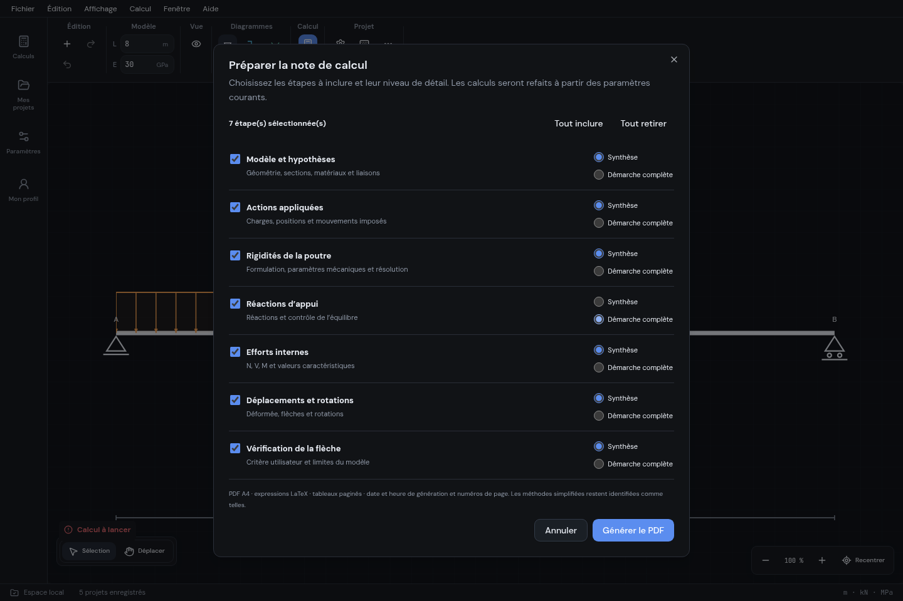
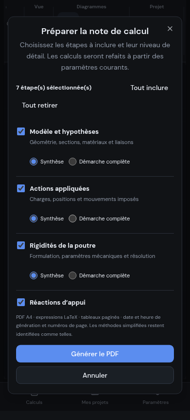

# Projets et notes de calcul — CaliSigma Structural

## Création et sauvegarde

Sur **Calculs**, « Ouvrir un projet » conduit à la bibliothèque. Sur **Mes projets**, « Nouveau projet » ouvre le choix des treize projets types, puis le formulaire du nom. Le projet est enregistré avant d’ouvrir son espace de travail.

Les modifications du modèle et du nom sont ensuite enregistrées automatiquement, après une courte temporisation de 400 ms. Quitter la page déclenche l’écriture des dernières modifications ; sur Desktop, la fermeture de la fenêtre attend cette écriture. Une erreur d’écriture reste visible et permet de réessayer. Le bouton Enregistrer reste disponible pour forcer une écriture, sans constituer une étape nécessaire de la création.

Les applications natives conservent le fichier `workspace.json` dans leur répertoire de données, avec écriture atomique et copie précédente. L’identifiant `com.structcalc.app`, le format des projets et la clé de stockage du navigateur sont conservés lors du changement de nom. Dans le navigateur, les projets restent dans le stockage local de ce navigateur. L’export JSON reste utile pour une copie indépendante ou un transfert entre appareils.

Les aperçus des projets enregistrés sont des images vectorielles dérivées de leur géométrie et de leurs charges. Ils évoluent avec le modèle sauvegardé et fonctionnent hors ligne, sans capture continue de l’écran. Ils ne reproduisent pas le zoom, le pan ou le diagramme actuellement affiché. Les illustrations des projets types restent inchangées.

## Confirmation des formulaires

Les paramètres globaux, la grille bâtiment, les détails de sélection, le catalogue des dimensions, les réglages détaillés, le calcul simplifié, les données des estimations BA, les préférences et le profil disposent d’une action explicite de validation ou de fermeture. Les formulaires déjà munis d’Appliquer conservent leur fonctionnement. Les paramètres modifiés en direct continuent de s’appliquer en direct : le bouton de validation vérifie les champs puis ferme le panneau.

## Préparation de la note PDF

Le bouton **Préparer la note de calcul**, dans le groupe Projet, ouvre le choix du contenu. Sur Desktop, la commande est également disponible dans Fichier et avec Ctrl/Cmd+P. Chaque projet type possède ses étapes propres.

Pour chaque étape, l’utilisateur choisit de l’inclure, puis **Synthèse** ou **Démarche complète**. Une sélection vide désactive l’export. Les calculs sont refaits sur une copie des paramètres courants ; les résultats périmés affichés précédemment ne sont pas réutilisés. Une incohérence ou une instabilité bloque la génération et laisse les choix disponibles pour réessayer.

Les notes A4 contiennent les hypothèses, les résultats et, selon le détail demandé, les expressions, coefficients et applications numériques de la méthode effectivement utilisée. Les équations LaTeX sont rendues en vecteurs. Les tableaux sont paginés avec répétition de leur en-tête. Chaque page comporte **CaliSigma Structural**, la date et l’heure de génération, ainsi que **Page x / y**. Les polices sont embarquées et l’export ne dépend pas d’un service externe.

Les notes d’analyse précisent le modèle mécanique et le critère utilisateur de flèche. Les notes de descente distinguent apports locaux et cumulés, poids propres, dégression et combinaisons. Les huit modules actuels d’estimation BA sont décrits comme des estimations initiales ; les vérifications réglementaires qu’ils n’effectuent pas ne sont pas présentées comme acquises.

[Exemple complet — analyse de poutre](project-library-preview/note-poutre.pdf) · [Exemple complet — bâtiment](project-library-preview/note-batiment.pdf)

## Vérifications

Les tests couvrent les treize générateurs de notes et d’aperçus, le rendu de leurs expressions LaTeX, l’exclusion des étapes décochées, le recalcul des réactions et le pied de page. Les parcours navigateur vérifient la création sans sauvegarde manuelle, la restauration après rechargement, la mise à jour des images, la validation des formulaires, le téléchargement d’un véritable PDF, les erreurs de modèle et l’annulation pendant une écriture native lente.

Les captures ci-dessus proviennent de l’interface exécutée dans Chromium avec détection du format natif, à 1440 × 960 et 390 × 844. Les valeurs des exemples sont des modèles de démonstration. Les contrôles visuels Impeccable ont été effectués sur les captures et les fichiers PDF ; les builds et contrôles Windows réels sont disponibles dans les exécutions GitHub Actions associées à la PR.
