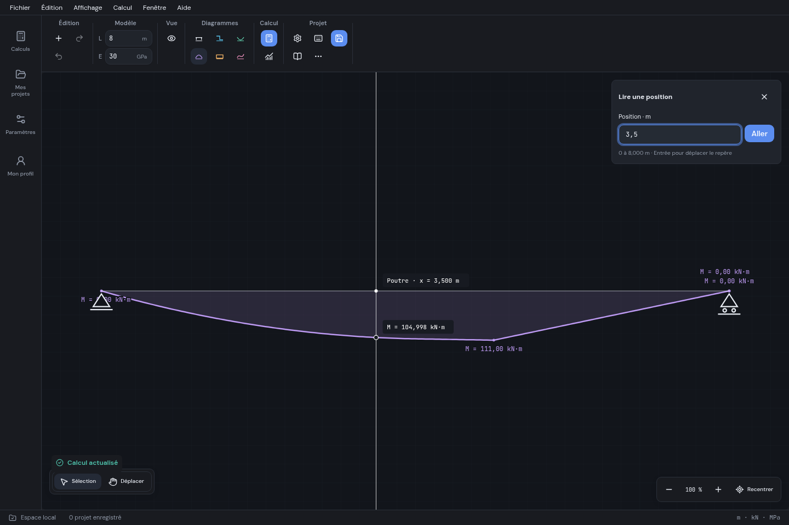
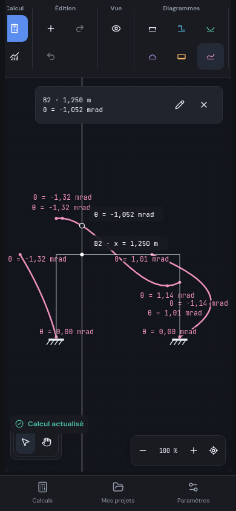
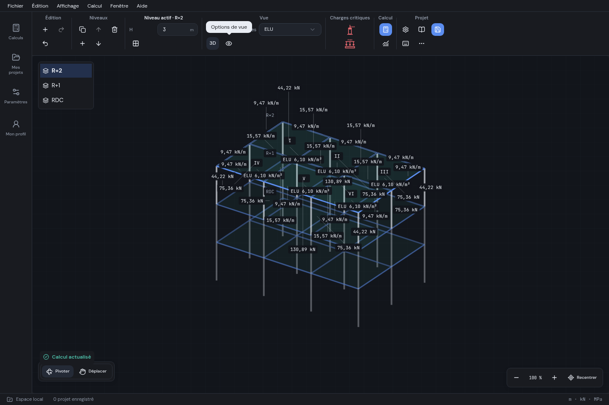
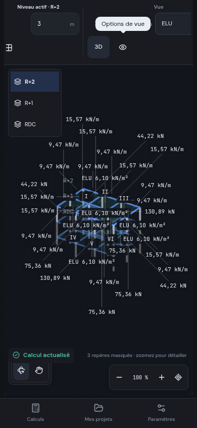
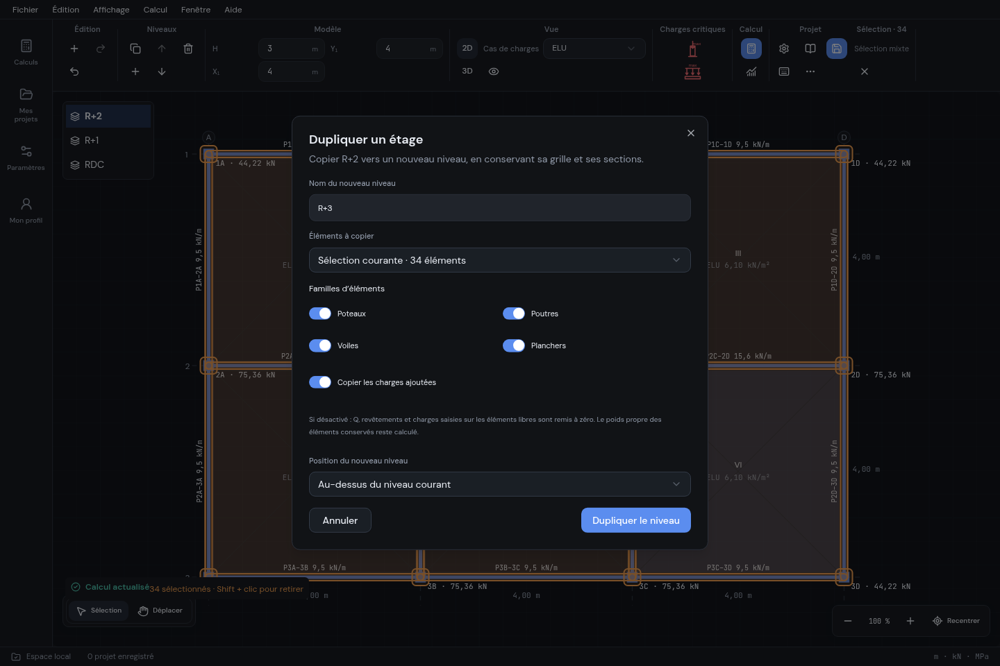

# Lecture précise et navigation dans le bâtiment

Les polices et les icônes de projets existantes sont conservées. Les captures utilisent Chromium avec l’intégration Tauri simulée ; les workflows vérifient aussi le véritable EXE Windows.

## Saisir une position

Sur Desktop, survolez une poutre ou une barre, puis commencez à taper une distance. La saisie remplace la position affichée sans déplacer le trait blanc. **Entrée** valide la distance et déplace le repère ; les valeurs du diagramme suivent la nouvelle position. Le repère reste fixé pendant la lecture précise. Fermez le petit panneau, ou utilisez **Échap**, pour reprendre le survol.

Les virgules et les points décimaux sont acceptés, dans l’unité de lecture du projet. Une valeur incorrecte, négative ou dépassant la longueur disponible affiche une erreur et laisse le repère à sa dernière position valide. Les extrémités 0 et L sont accessibles. Si la position validée est hors champ, la vue se déplace juste assez pour la montrer, sans changer le zoom. Pendant la saisie, 0 et le signe moins ne déclenchent pas les raccourcis de la caméra.

Sur mobile, **Lire une position** active la lecture sans modifier la structure. Touchez le schéma ou choisissez la barre, saisissez la distance sur le clavier décimal, puis utilisez **Aller**. Le panneau se réduit pour dégager le dessin ; le crayon permet de modifier la position à nouveau. La position reste fixée pendant le zoom. Le clavier et les champs habituels d’édition ne sont pas détournés par cette lecture.

## Résultats des analyses

Le contrôle de flèche est placé immédiatement sous la carte **Flèche maximale |v|**, pour les poutres comme pour les cadres. Le déplacement nodal du cadre reste une grandeur distincte. Le critère admissible reste réglable par projet, sans changement du solveur ni de la portée de cette comparaison élastique.

## Bâtiment : commandes et niveaux

Le header conserve une hauteur fixe. Les groupes Édition, Niveaux, Niveau actif, Vue, Charges critiques, Calcul et Projet se suivent ; la sélection apparaît en dernier. Le groupe Projet utilise un engrenage pour les paramètres. Les paramètres essentiels de la sélection restent dans le header ; **Modifier** ouvre les paramètres détaillés, également accessibles par clic droit. Les grandes listes, les switches et les longs choix d’annotations quittent le header.

Le groupe **Niveau actif · R+2** indique explicitement le niveau modifié, en plan comme en 3D. Il contient sa hauteur et le bouton **Grille du niveau actif**, qui ouvre toutes ses travées. Les raccourcis X₁/Y₁ sont retirés. Le niveau actif ressort légèrement dans le volume 3D.

Les boutons **2D** et **3D** portent un texte explicite. Les deux icônes rouges « max » représentent respectivement un poteau avec une force verticale et une poutre avec son chargement réparti. Leurs noms accessibles et infobulles précisent leur action.

Dans le dessin, la liste des niveaux est classée du sommet vers le RDC. Le niveau courant apparaît en gras. Cette liste reste disponible en 2D et en 3D, et défile quand le bâtiment contient de nombreux niveaux.

## Rotation et annotations 3D

Le modèle tourne autour du centre de son volume, avec une échelle indépendante de l’angle. Le geste horizontal tourne autour de l’axe vertical ; le geste vertical bascule autour de l’axe horizontal. Le premier mouvement choisit l’axe du geste pour éviter les rotations parasites. **Vue → Rotation 3D** permet aussi d’imposer un axe. Les commandes Déplacer, zoom et Recentrer restent disponibles.

Le menu **Vue → Annotations** règle les repères et les valeurs des planchers, poutres, poteaux et voiles. L’affichage sur tous les niveaux, les noms de niveaux, les axes de grille et les surfaces d’influence disposent aussi de commandes dédiées. Sur mobile, les sous-menus se parcourent dans un panneau unique avec Retour.

Les annotations 3D sont placées en évitant les collisions, avec des traits de rappel si nécessaire. Le repère de l’élément critique est prioritaire. Quand la place manque, les annotations excédentaires sont masquées et un compteur invite à zoomer. Leur taille à l’écran reste stable pendant le zoom, qui permet d’espacer les éléments et de lire davantage de valeurs.

## Duplication et sélection

**Dupliquer** ouvre un formulaire : tout le niveau ou la sélection courante, familles à copier, conservation des charges ajoutées, nom du nouveau niveau et insertion au-dessus du niveau courant ou au sommet. La grille et les sections sont conservées. Sans charges ajoutées, Q, revêtements et charges saisies sur les éléments libres sont remis à zéro ; les poids propres continuent d’être calculés. Le nouveau niveau possède ses propres identifiants et reste indépendant de sa source. Une duplication vide est refusée.

Dans les espaces d’édition structurale Desktop, **Ctrl+A** sans présélection sélectionne toutes les familles ; pour le bâtiment, la sélection porte sur le niveau courant. Avec une présélection homogène, Ctrl+A sélectionne tous les éléments de même nature. **Shift+clic** ajoute ou retire un élément sans perdre le reste de la sélection. Les paramètres communs sont proposés quand la sélection est homogène ; une sélection mixte affiche son nombre d’éléments et peut être filtrée ou dupliquée.

## Vérifications

Les tests couvrent la conversion des unités et les limites de saisie, les copies partielles et leurs identifiants, la rotation rigide, l’absence de chevauchement entre annotations et les sélections mixtes. Les parcours Desktop/mobile vérifient les champs, les erreurs, le toucher, le zoom, les niveaux, la duplication, le header fixe et les raccourcis. Le test de l’EXE Windows vérifie également la saisie au clavier avant/après Entrée et les nouvelles commandes du bâtiment.

Les noms de poutres, poteaux et voiles sont retirés du volume 3D. Pour lire un élément, sélectionnez-le puis utilisez **Isoler les annotations de cet élément**, ou **Vue → Annotations de l’élément sélectionné**. La structure reste visible ; seules les annotations de cet élément restent affichées. La lecture suit la sélection et le cas de charges. La commande inverse rétablit les réglages par famille. [Détails et captures des appuis et annotations](structure-annotations.md).
