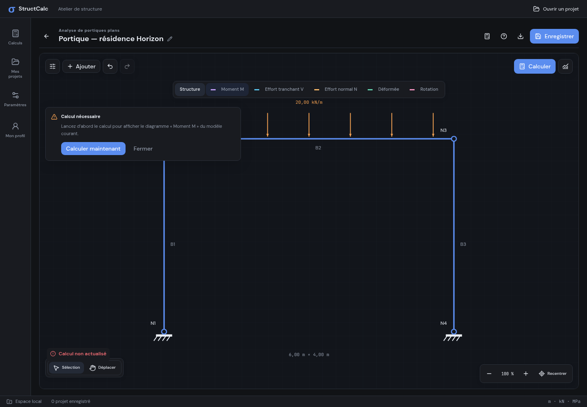
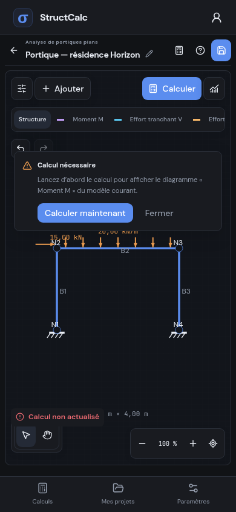
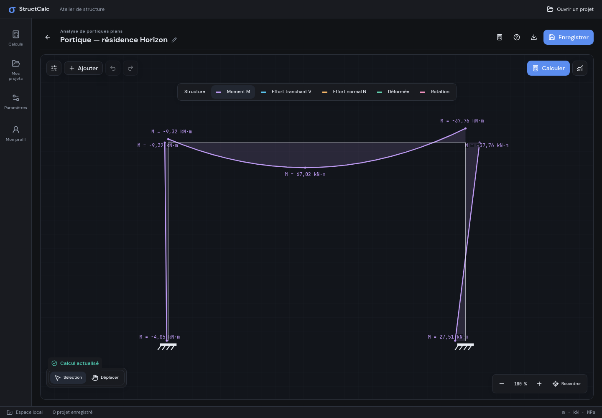
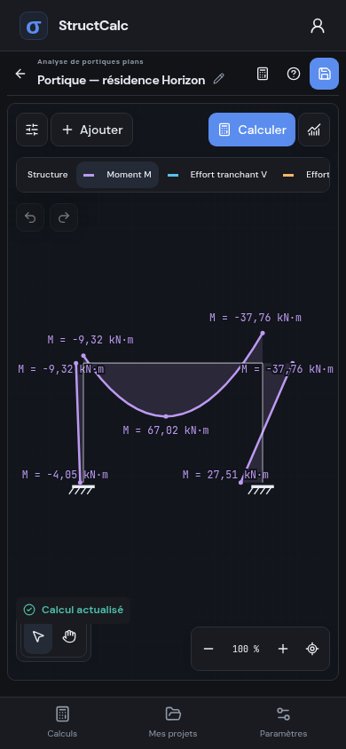
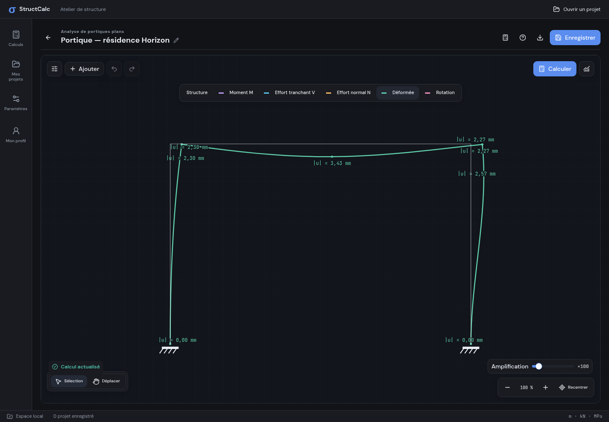
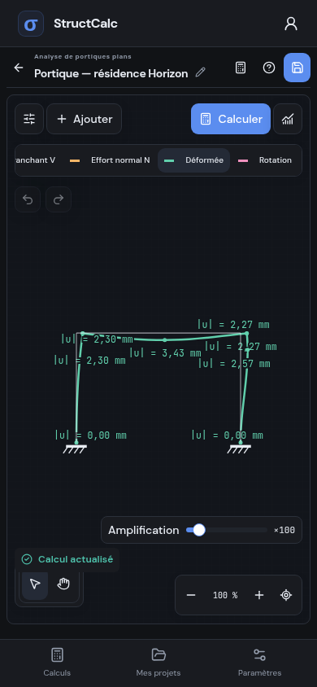
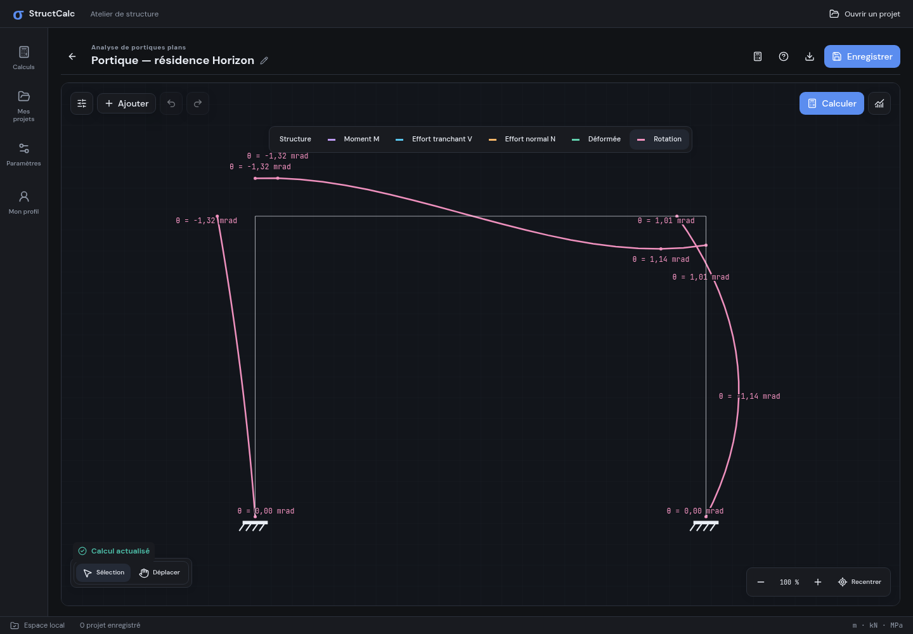
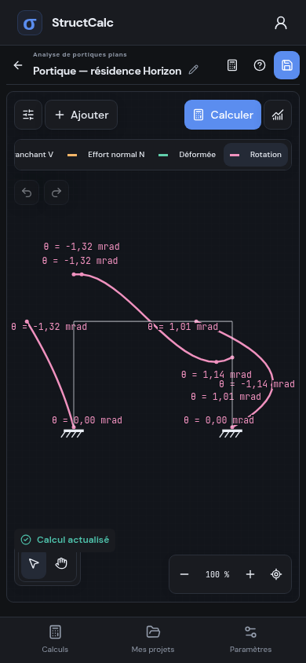

# Réactions et diagrammes liés au dernier calcul

Les réactions et les cinq champs de résultats utilisent le même calcul du modèle courant. Toute modification de géométrie, d’appui, de section, de matériau ou de charge masque immédiatement les résultats graphiques périmés. Le réglage d’affichage des réactions est conservé, mais son interrupteur reflète leur disponibilité réelle.

Une tentative d’affichage sans calcul à jour donne un message « Calcul nécessaire » avec l’action **Calculer maintenant**. Un résultat arrivé après une nouvelle modification du modèle ne valide pas cette modification. Changer de vue ou d’amplification ne nécessite pas de recalcul.

## Des vues de résultats épurées

La vue Structure conserve les charges, repères, sections, cotes, sélection et réactions disponibles. Les vues de diagrammes affichent seulement les appuis, les axes initiaux fins et le champ choisi avec ses valeurs. Les charges, réactions et cadres de sélection y sont masqués. Le retour à Structure restitue l’affichage du modèle et des réactions actualisées.

Pour les portiques, les champs **M, V et N** comportent un remplissage entre chaque courbe et l’axe de sa barre. Chaque barre porte les valeurs de ses extrémités et les extrema des points du calcul ; les valeurs communes à une station ne créent pas de doublons React lors du changement de champ.

Les **déplacements et rotations** restent sans remplissage. Les rotations sont indiquées en mrad. Sur le portique déformé, **|u|** désigne la norme du déplacement global en mm ; sur la poutre, **v** désigne la flèche en mm. Les nombres restent ceux du calcul : l’amplification déplace uniquement le dessin. Un placement des annotations évite les superpositions simples aux nœuds communs sans supprimer de valeurs.

## Dimensionnement Béton Armé

Ce nom remplace la famille « Prédimensionnement » dans le catalogue, les filtres, les descriptions des huit projets, leurs pages, l’onboarding, le guide et les préréglages. Les identifiants des projets et les sauvegardes existantes restent compatibles. Les polices et les icônes validées sont conservées.

Cette évolution renomme et précise l’interface ; elle ne remplace pas les méthodes simplifiées existantes par un nouveau moteur de ferraillage. Leur portée demeure indiquée dans les pages de calcul.

## Vérifications

Les tests couvrent la sélection des extrémités et extrema, les déplacements globaux réels aux nœuds, le placement des annotations et les conversions d’unités. Les parcours desktop/mobile vérifient le blocage explicatif, l’invalidation des réactions, leur actualisation après calcul, les scènes épurées, le remplissage limité aux efforts internes et la cohérence des textes de la nouvelle famille.
