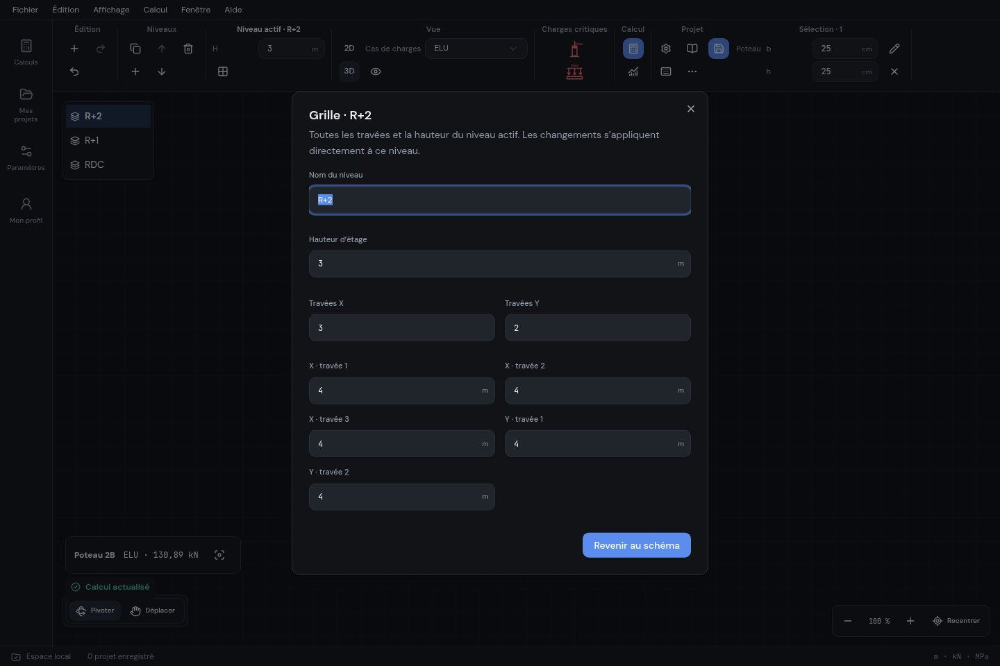
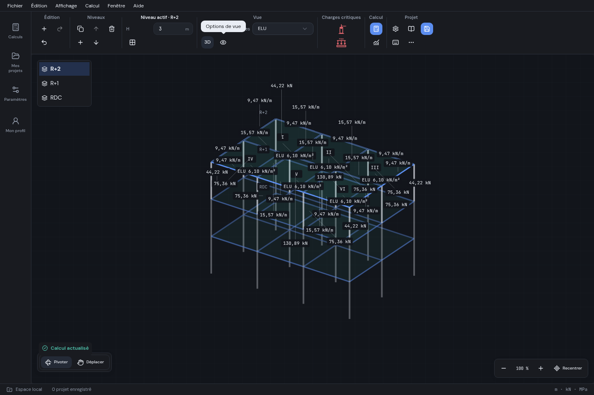
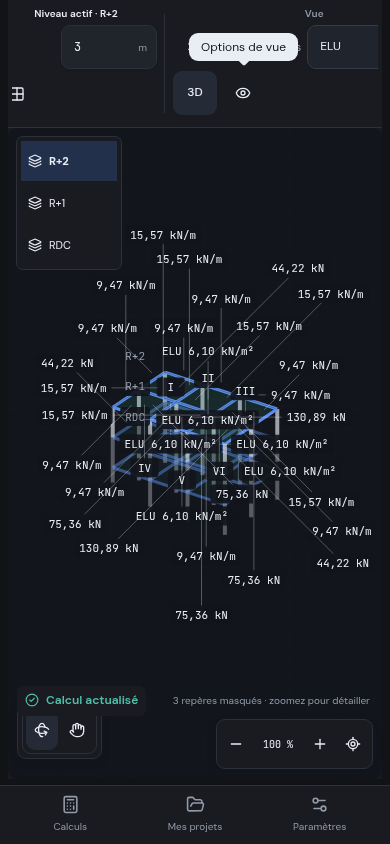
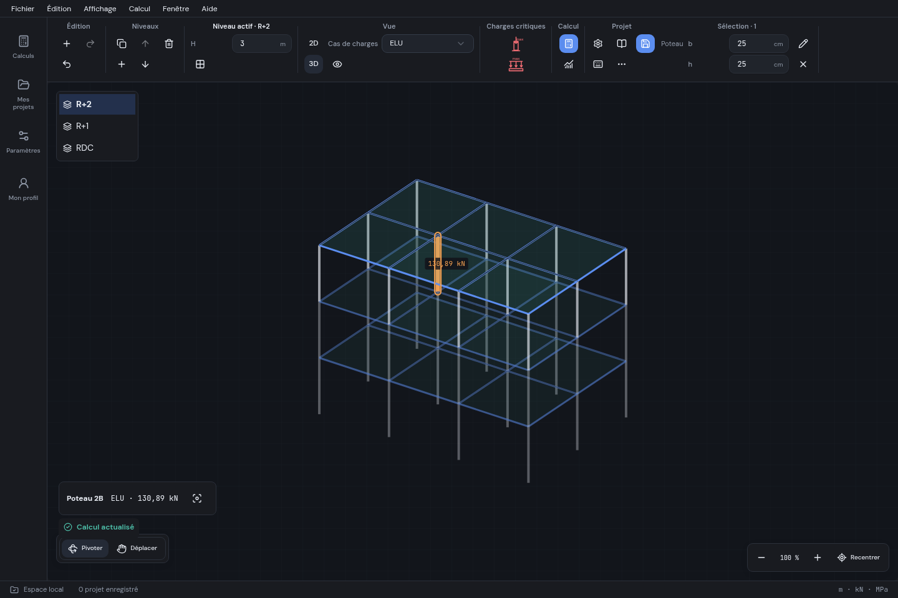
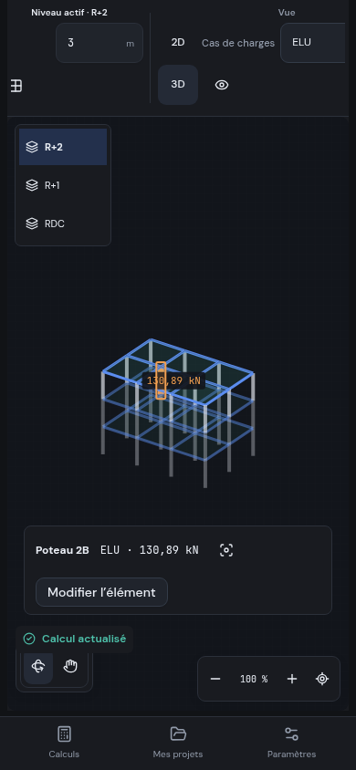
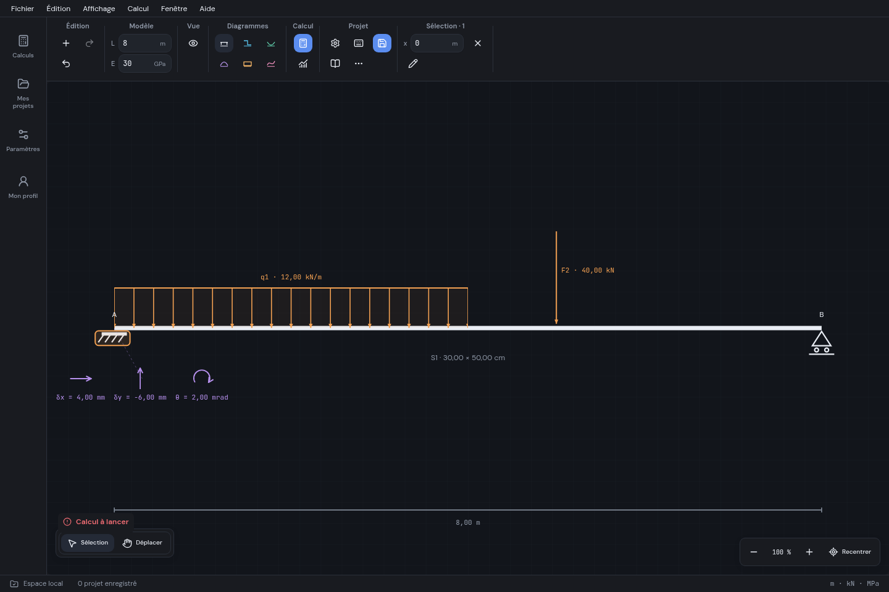
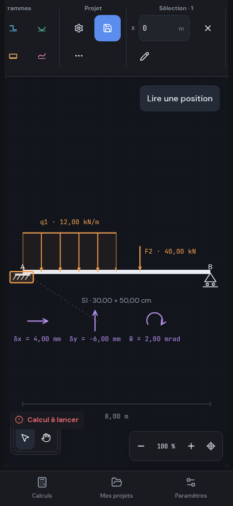
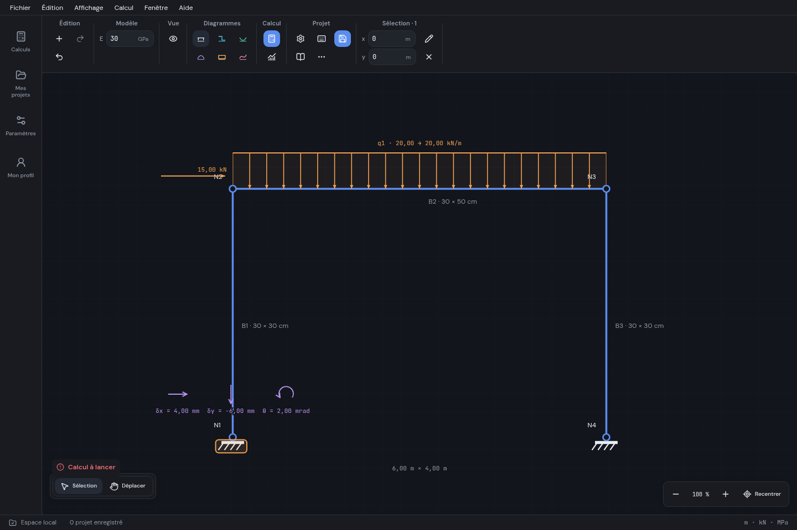
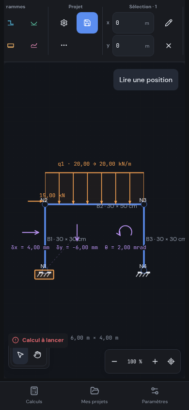

# Niveaux actifs, annotations 3D et mouvements imposés

Les neuf captures montrent la compilation de production dans Chromium, avec Tauri simulé, sur Desktop et mobile. Le workflow Windows vérifie aussi la grille et l’isolation des annotations dans le véritable EXE WebView2.

## Une grille clairement rattachée au niveau actif

Le groupe **Niveau actif · R+2** remplace **Modèle** en plan et en 3D. Sa hauteur et son bouton **Grille du niveau actif** concernent exclusivement cet étage. La grille ouvre toutes les travées X/Y et leur nombre, le nom et la hauteur du niveau ; les raccourcis limités à X₁/Y₁ ont disparu. Le ruban conserve sa hauteur et son défilement horizontal, y compris avec un nom de niveau long.

La liste du dessin reste classée du sommet au RDC. Le niveau actif y apparaît en gras, et sa géométrie ressort dans le volume 3D. Les niveaux voisins restent visibles. Le guide de première utilisation accompagne l’ouverture de la grille, la modification d’une portée puis le retour au dessin.

## Lire la 3D sans multiplier les noms

Les textes « Poutre… », « Poteau… » et « Voile… » ne sont plus dessinés dans le volume. Les repères du plan restent réglables ; les dalles conservent leurs repères courts. Le menu **Vue → Annotations** règle les valeurs par famille, les noms de niveaux et leur périmètre. Les valeurs de charges restent liées au cas G, Q, ELS ou ELU et à un calcul actualisé.

Sélectionnez un seul élément puis utilisez **Isoler les annotations de cet élément**, dans son bandeau de lecture, ou **Vue → Annotations de l’élément sélectionné**. Toutes les autres annotations disparaissent, y compris les noms des étages, et l’ensemble de la structure reste visible. Le mode donne la valeur de cet élément même si les valeurs de sa famille étaient masquées. Il suit la sélection et le cas de charges, sans modifier les réglages généraux d’annotations. **Afficher les autres annotations** les rétablit. Changer de niveau ou désélectionner quitte cette lecture isolée.

Les annotations restantes continuent d’éviter les collisions, avec traits de rappel et suppression de l’excédent quand la place manque.

## Déplacements et rotations imposés aux appuis

Dans **Modifier** un appui de poutre ou un nœud lié au sol de cadre, les trois champs de mouvement imposé sont regroupés directement dans le formulaire. Les directions libres sont désactivées et ignorées par le calcul. Un ressort reçoit le déplacement de son ancrage, pas un blocage artificiel de son nœud.

Les mouvements non nuls sont dessinés en violet : flèche horizontale δx, flèche verticale δy et flèche courbe θ. Le sens suit le signe saisi ; les valeurs sont en mm et mrad. Les longueurs de flèches sont symboliques. Les textes gardent une taille lisible pendant le zoom et sur téléphone. **Vue → Annotations → Appuis → Déplacements imposés** masque ou rétablit ces indications.

- Poutres : x positif vers la droite, tassement positif vers le bas, rotation positive horaire. Les conventions du solveur existant sont conservées.
- Cadres : repère global, x positif vers la droite, y positif vers le haut et rotation positive antihoraire. Le formulaire rappelle cette convention.

Les déplacements imposés de cadre sont sauvegardés dans les nœuds, avec zéro implicite pour les anciens projets. Le système libre résout **Kff uf = Pf − Kfc uc**, en ajoutant les déplacements d’ancrage aux actions élastiques. Les réactions et les efforts sont calculés à partir du déplacement complet. Les actions d’ancrage ne sont pas comptées comme des charges extérieures dans le bilan d’équilibre.

Toute modification de mouvement imposé invalide le calcul : les réactions et diagrammes cessent de s’afficher jusqu’au recalcul. Les diagrammes conservent leur lecture épurée : appuis, axes fins et courbe ; les mouvements imposés restent des annotations de la vue Structure.

## Vérification

Les tests mécaniques comparent les résultats à des solutions analytiques : tassement différentiel d’une barre bi-encastrée, rotation, allongement axial, mouvement rigide d’une console inclinée subdivisée et déplacement d’ancrage d’un ressort, avec ou sans force appliquée. Ils vérifient aussi les anciennes données et l’absence d’effet sur une direction libre.

Les parcours Desktop/mobile couvrent la grille complète et son indépendance entre niveaux, le guide initial, le header fixe, l’isolation d’un poteau puis d’une dalle, les cas de charges, l’absence de noms superflus, les flèches et leur sens, la lisibilité sans chevauchement, les menus d’affichage, l’invalidation et la conservation des mouvements après sauvegarde/rechargement. La suite générale vérifie les comportements précédents.

Adaptation d’interface guidée par [Impeccable](https://github.com/pbakaus/impeccable), en conservant les polices et les icônes de projets.
