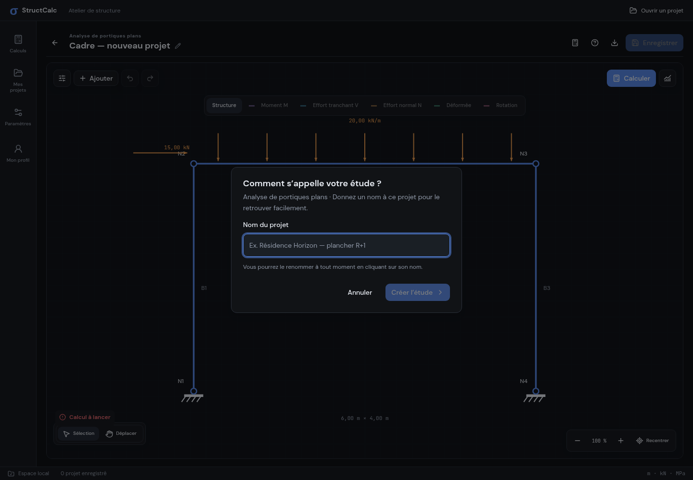
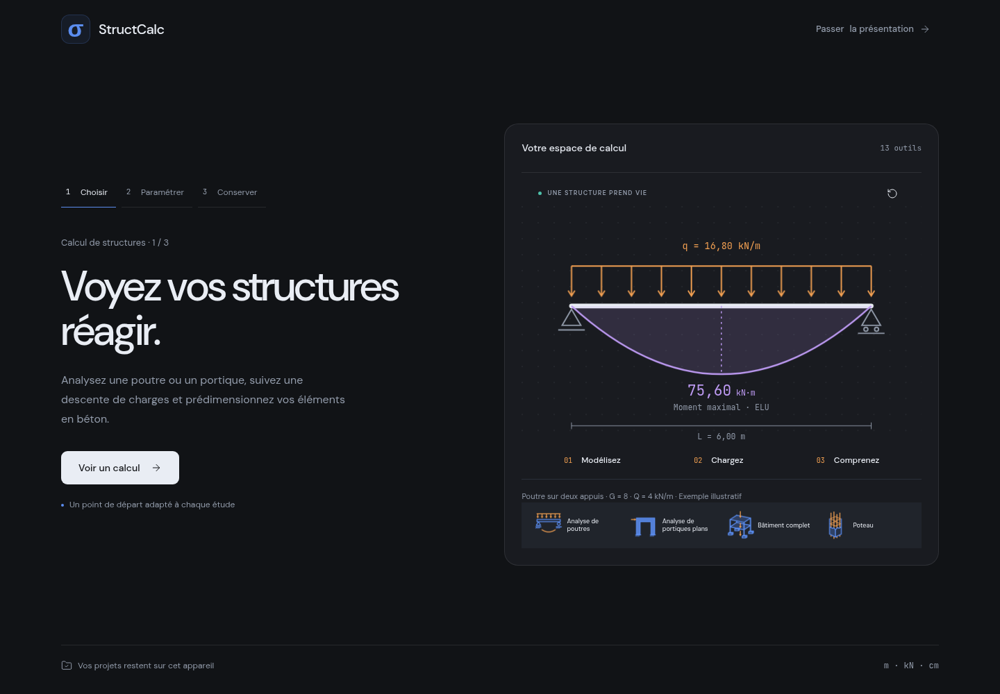
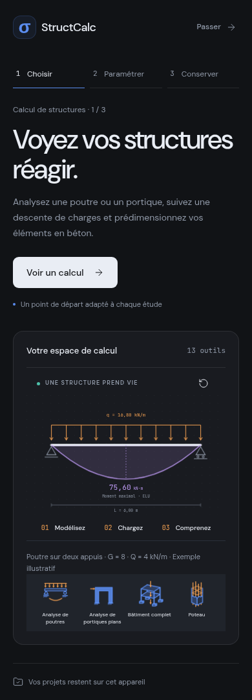
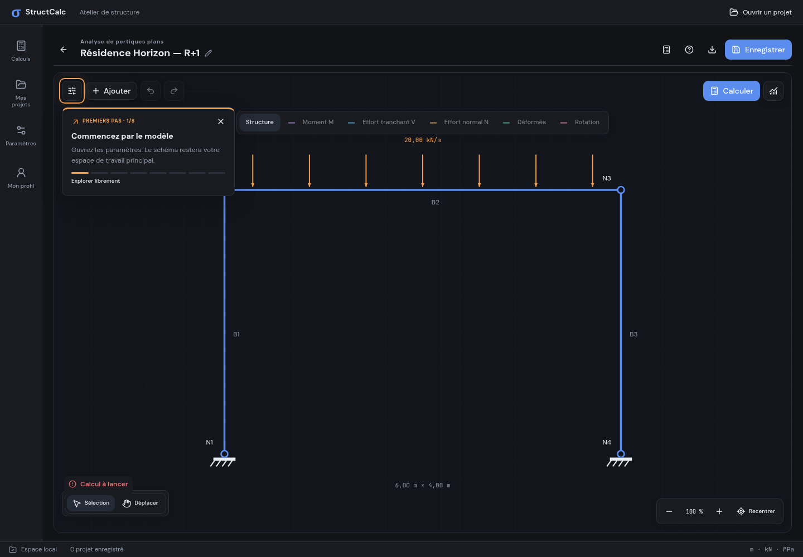
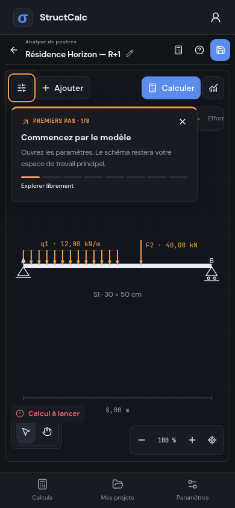
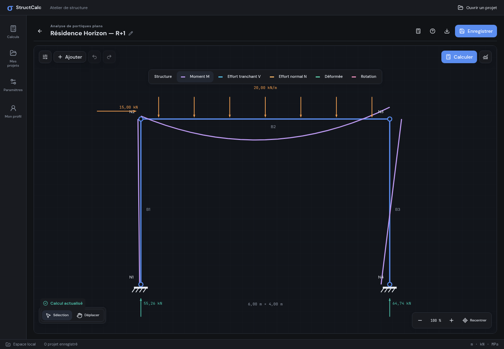
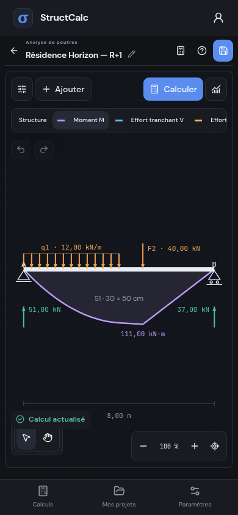
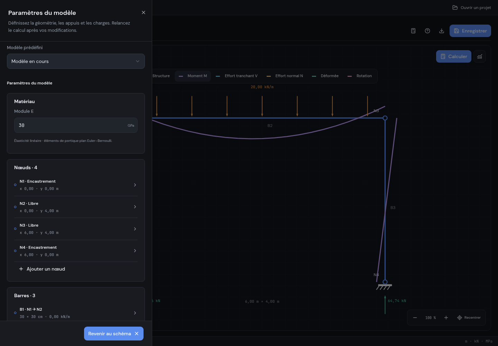
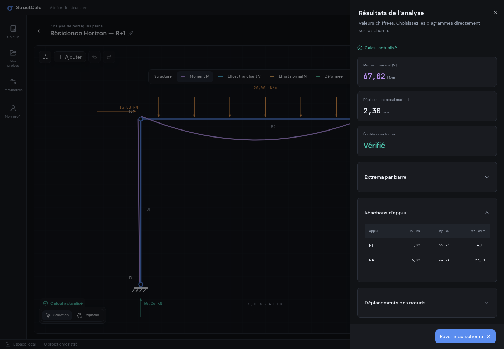
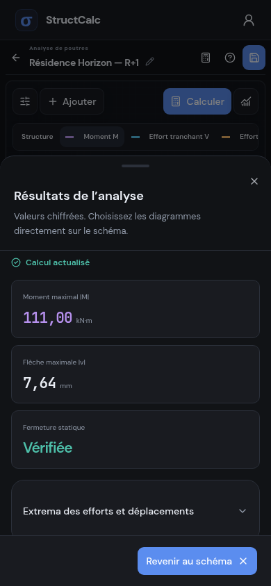

# Une étude guidée, du nom aux résultats

Cette évolution remplace les panneaux permanents des analyses par un dessin pleine largeur et un lancement explicite du calcul. Les identifiants des projets, les 13 icônes approuvées et les fichiers DM Sans / JetBrains Mono restent inchangés.

## Entrer dans une étude

Chaque nouveau projet commence par une boîte « Comment s’appelle votre étude ? », avec un champ obligatoire, un exemple et l’action « Créer l’étude ». Le nom occupe ensuite le titre du projet ; cliquer sur son nom permet de le renommer. La création reste un brouillon jusqu’à « Enregistrer ».

## Un onboarding qui montre le produit

Une poutre se construit, ses charges apparaissent, puis son diagramme des moments se trace. L’exemple utilise les résultats réels de la poutre simplement appuyée : G = 8, Q = 4 kN/m, portée de 6 m et moment ELU de 75,60 kN·m. La séquence peut être rejouée. L’étape suivante permet de modifier la portée ; la dernière illustre la sauvegarde et l’export. Les transitions et l’assemblage respectent la préférence système de réduction des animations.

## Des premiers pas liés aux actions

Chaque type dispose de son guide : modèle et élément pour les analyses ; système, surface, niveaux et calcul pour les descentes ; trame et calcul pour le bâtiment ; paramètres et enregistrement pour les prédimensionnements. Le repère animé se déplace après l’action attendue, sans bouton « Suivant » artificiel. Les panneaux affichent également l’instruction dans leur contenu accessible.

Le guide peut être passé et rejoué par le bouton d’aide du projet. Son achèvement est enregistré séparément pour chaque type, dans la sauvegarde web et dans le fichier Rust natif. Un parcours interrompu reprend au début ; un parcours terminé ne se relance plus spontanément.

## Analyse de poutres et de portiques plans

Ces noms remplacent « Calculateur de poutres / cadres ». Le header est compact. Les paramètres s’ouvrent à gauche et les résultats numériques à droite sur desktop ; sur téléphone, les panneaux apparaissent en bas. Ajouter, sélectionner, déplacer, calculer, choisir un diagramme et régler le zoom sont des commandes du playground quadrillé.

Les diagrammes M, V, N, déplacement et rotation se dessinent sur la structure entière, avec des couleurs distinctes. Le portique conserve une zone de prise au clic confortable malgré des traits porteurs affinés. Les anciennes courbes externes et le sélecteur de barre sont supprimés.

## Calcul explicite et état des résultats

Le lancement affiche un voile ombré avec fondu, un indicateur d’activité et « Calcul en cours ». Aucun pourcentage fictif. Le moteur travaille dans un worker (avec le même moteur après affichage du loader si la WebView ne peut pas charger les workers) et les résultats appartiennent à une copie du modèle réellement calculé. Une modification invalide les diagrammes et indique en rouge « Calcul non actualisé » jusqu’au prochain calcul réussi. Une erreur est affichée et ne valide jamais les résultats.

Les descentes sur poteau, voile et bâtiment ouvrent leur vue de résultats après le calcul réussi. Les modèles de prédimensionnement conservent leur réponse immédiate, adaptée à ces formulaires simples.

## Surface d’influence du poteau

Les quatre longueurs saisies délimitent maintenant entièrement la zone colorée : **A = (L₁ + L₂) × (L₃ + L₄)**. Avec quatre longueurs de 3 m, A = 36 m². Les champs de section des poutres principales ont le carré orange du dessin ; ceux des secondaires, son carré vert.

Les anciennes études utilisaient les demi-portées. À leur ouverture, les valeurs sans marqueur `tributaryConvention` sont converties une seule fois en longueurs d’influence, en conservant leur surface et leurs efforts existants. Un message explique cette conversion. Les études nouvelles et réenregistrées portent le marqueur `full-spans`. La largeur tributaire du voile conserve sa règle précédente.

## Vérification et limites

Les tests couvrent les calculs numériques, la conversion des anciennes études, la persistance native du guide, les parcours desktop/mobile, l’état périmé des résultats, les erreurs, les panneaux, le zoom/pan et les diagrammes sur toutes les barres. Les captures des layouts natifs utilisent Chromium et une frontière IPC simulée. Le workflow Windows vérifie en plus l’EXE réel et sa sauvegarde Rust ; les captures ne remplacent pas une observation sur téléphone physique.

Direction et audit adaptés du skill [Unslop](https://github.com/heydamir/unslop), par **Damir Sokolovsky (@heydamir)**, sous licence **CC BY 4.0**. Les animations structurelles et les choix de parcours répondent à la demande produit de cette évolution.
