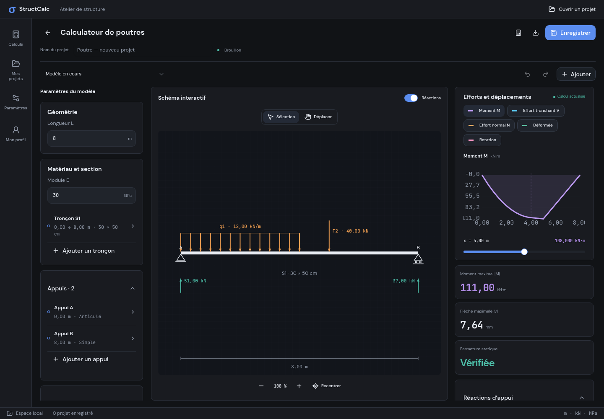
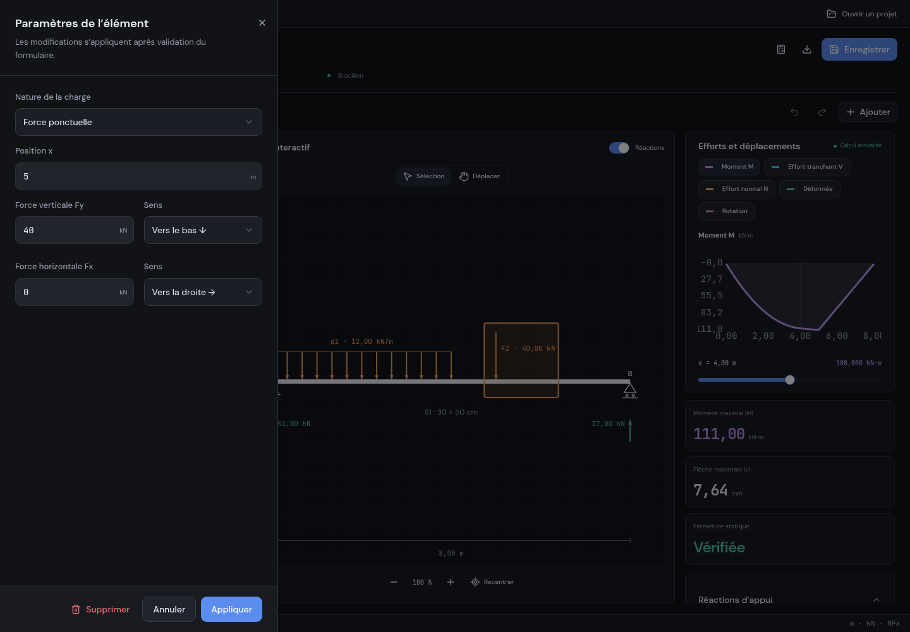
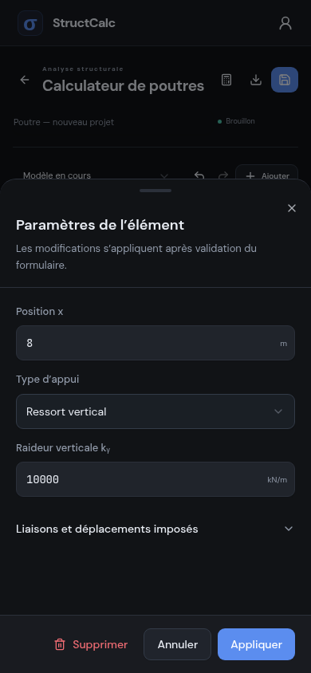
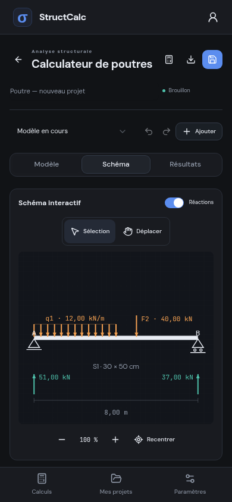
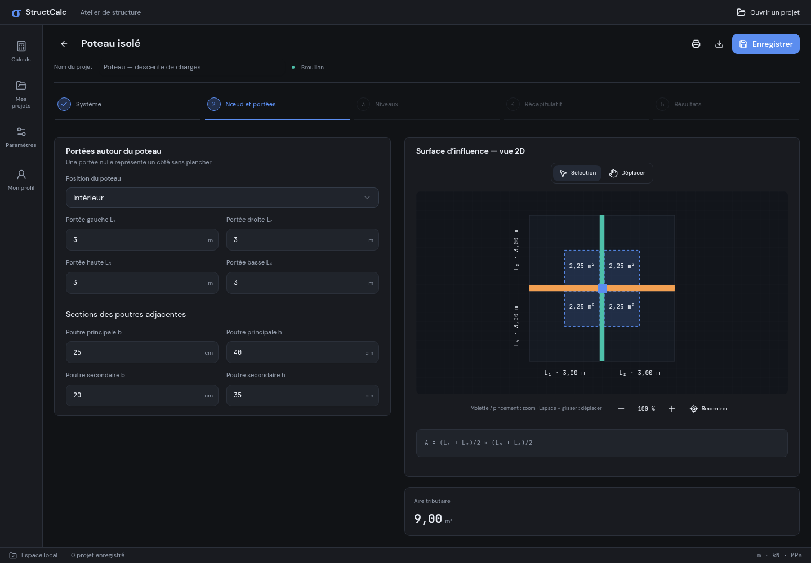
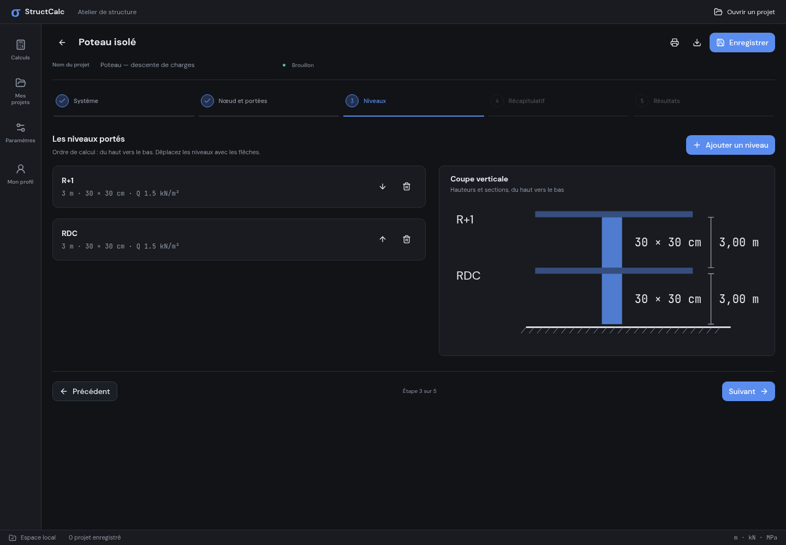
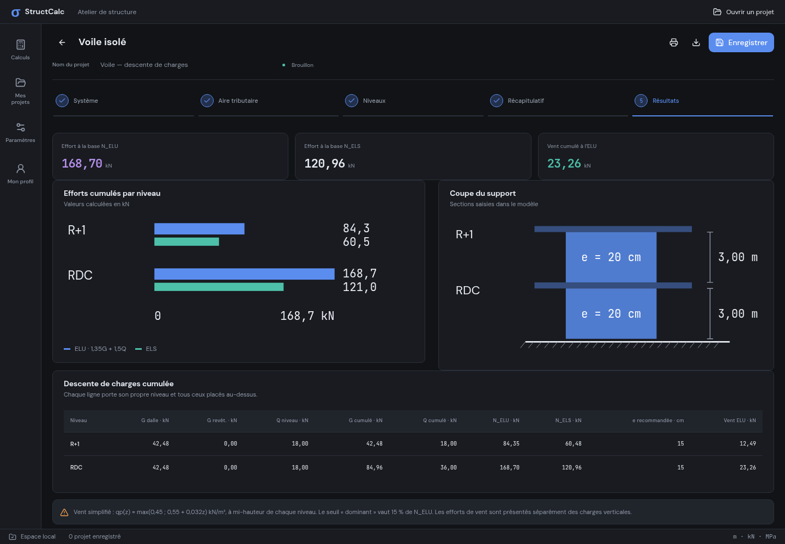
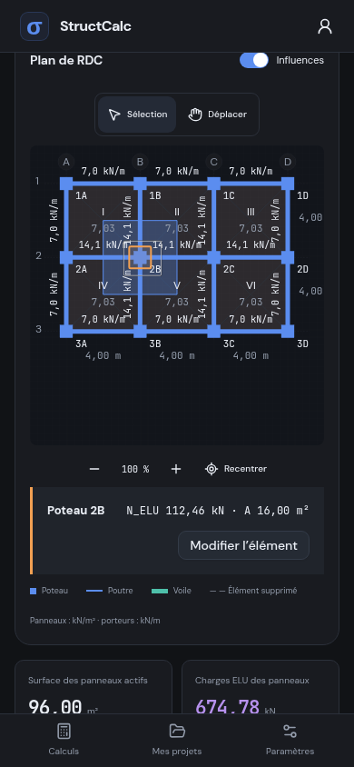

# Espaces desktop/mobile et schémas

Le navigateur conserve son layout avec la barre latérale et le catalogue existants. L’application Tauri desktop utilise un atelier avec une navigation compacte, une barre de commandes, un état de l’espace local et, sur une fenêtre large, trois zones indépendantes : paramètres, dessin, résultats. Sur une fenêtre plus étroite, les résultats passent sous le dessin.

## Direction et audit

Travail guidé par [Unslop](https://github.com/heydamir/unslop), de Damir Sokolovsky (@heydamir), CC BY 4.0.

- **Produit :** calcul de structures, modélisation et lecture des efforts pour les ingénieurs.
- **Caractère :** précis, dense, lisible.
- **Univers :** l’atelier de calcul et le plan de structure.
- **Moments :** le dessin interactif et les diagrammes calculés ; les surfaces de navigation restent sobres.
- **Signature :** les cotes, repères de nœuds et sections, avec les valeurs en JetBrains Mono.

L’audit a relevé une navigation identique entre navigateur et natif, des dessins contenus dans un cadre trop horizontal sur téléphone, des traits devenant très fins après mise à l’échelle, des annotations de plans qui se chevauchaient, des couleurs identiques pour des grandeurs différentes et des formulaires centraux éloignés du dessin. La correction porte sur ces points. Les fichiers DM Sans, JetBrains Mono et les 26 variantes des 13 icônes approuvées sont conservés.

## Édition

Les appuis, charges, sections, nœuds, barres et éléments du bâtiment s’éditent dans un sheet à gauche sur desktop, en bas sur téléphone. Les niveaux de descente de charges suivent le même fonctionnement. Le formulaire conserve un brouillon : « Appliquer » valide, « Annuler », Échap ou la fermeture abandonnent les modifications. Le sheet mobile peut se fermer en glissant sa poignée. Son contenu défile et les actions restent accessibles quand la hauteur disponible diminue.

La sélection reste entourée d’un rectangle orange translucide après fermeture de l’éditeur. Un clic dans le fond vide la sélection ; le déplacement et le pincement ne déclenchent pas l’éditeur.

## Dessins et résultats

Le cadre SVG s’adapte au rapport largeur/hauteur de sa zone. Les traits porteurs ont une épaisseur lisible à l’écran ; les appuis, nœuds et annotations tiennent compte de la taille du viewport. Le zoom, le panoramique, le recentrage et les interactions tactiles sont conservés.

| Grandeur           | Couleur   |
| ------------------ | --------- |
| Moment M           | Violet    |
| Effort tranchant V | Bleu/cyan |
| Effort normal N    | Ambre     |
| Déplacement v      | Vert      |
| Rotation θ         | Rose      |

Le ressort vertical est dessiné avec sa liaison au sol. Le calculateur de cadres dispose désormais d’un appui élastique vertical de raideur `kᵧ` en kN/m ; translation horizontale et rotation restent libres. Sa réaction vaut `−kᵧ·uy`. Les déplacements transversaux et rotations des barres proviennent des fonctions d’interpolation du portique avec la contribution des charges réparties.

## Éléments rétablis depuis Flutter

| Source Flutter                          | Interface React                                                                                                                                                          |
| --------------------------------------- | ------------------------------------------------------------------------------------------------------------------------------------------------------------------------ |
| `widgets/node_tributary_diagram.dart`   | Quatre zones autour du poteau, aires de chaque contribution, portées L₁–L₄ et largeur réelle des poutres adjacentes ; zoom et panoramique                                |
| `widgets/building_profile_view.dart`    | Coupe verticale du poteau ou du voile, niveaux ordonnés, hauteurs, sections saisies, dalles et sol hachuré                                                               |
| `ui/building/building_plan_canvas.dart` | Bissectrices à 45° avec triangles/trapèzes, régions alimentant la poutre/voile sélectionné, quarts de dalle repris par le poteau sélectionné, repères des nœuds et cotes |

Les éléments supprimés ne sont plus représentés comme recevant une influence. Dans les résultats du bâtiment, sélectionner un élément montre ses contributions sans ouvrir automatiquement le formulaire ; « Modifier l’élément » ouvre l’éditeur. Les annotations de résultats utilisent les efforts calculés. Les formules de descente de charges et de répartition par étage sont conservées.

Les résultats poteau/voile ajoutent également une comparaison ELU/ELS des efforts cumulés, issue des mêmes lignes de calcul que le tableau.

## Barres système et clavier

Le header mobile est sticky. Le navigateur et iOS utilisent les zones de sécurité CSS, avec le décalage correspondant sur le header et les feuilles d’édition. Android applique les insets système et de découpe au conteneur natif de la WebView : son viewport commence sous la barre d’état et évite également la barre de navigation. Sur Android 11+, la zone du clavier est prise en compte par ce conteneur ; sur les versions antérieures, la fenêtre utilise `adjustResize`.

`npm run android:init` génère le projet avec Tauri puis applique `src-tauri/mobile/android/MainActivity.kt` via `tools/configure-android.mjs`. Le workflow Android utilise cette commande, pour que la correction survive à chaque régénération du projet.

## Vérification

Les tests numériques comparent ressorts, réactions, déplacements et rotations à des solutions analytiques. Les surfaces d’influence sont vérifiées sur panneaux carrés et rectangulaires. Les parcours Playwright couvrent les layouts web/natif, la sélection persistante, les deux côtés de sheet, le header avec zone de sécurité simulée, une hauteur de viewport réduite, le glissement de fermeture, les ressorts sauvegardés, les couleurs et les graphes actualisés.

Les captures de cette page sont celles de la véritable interface React, avec une frontière IPC simulée pour afficher les layouts natifs dans Chromium. Elles ne constituent pas une exécution Android sur appareil physique. Le workflow Windows ouvre toujours le véritable EXE et vérifie WebView2, le calcul et la persistance Rust ; le workflow mobile compile les applications natives.
